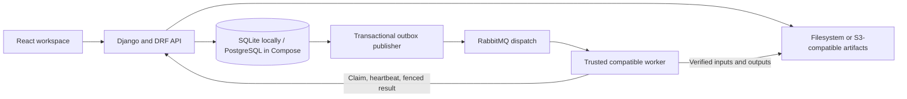

# ModelAnvil

<picture>
  <source media="(prefers-color-scheme: dark)" srcset="web/public/brand/modelanvil-logo-reversed.svg">
  <source media="(prefers-color-scheme: light)" srcset="web/public/brand/modelanvil-logo.svg">
  
</picture>

[](https://github.com/nirtuttnauer/ModelAnvil/actions/workflows/ci.yml) [](LICENSE)

A self-hosted workspace for dataset preparation, team labeling, and bounded model post-training and evaluation. A Django API records the data, runs, permissions and artifacts; a React app lets you inspect and operate those workflows.

ModelAnvil is a work in progress. Several local execution paths run real computations, while other screens and domain tests use explicit fixtures. Execution evidence, model quality, hardware support and production readiness are separate questions. The [capability audit](docs/engineering/capability-evidence.md) and [status ledger](docs/engineering/status.md) record the evidence and remaining gaps.

See the [supported capability baseline](docs/engineering/supported-capabilities.md) for current operation-specific evidence and limits. Overview exposes local workflow measurements; Evaluation records explicit accept/reject decisions after verified candidate/baseline comparisons. These measurements stay in the installation and exclude prompts and credentials.

The [main integration inventory](docs/engineering/integration-inventory.md) maps retained branches and remaining scopes. Current dependency pins require fresh GPU qualification; historical GPU reports do not qualify the upgraded stack.

[Start locally](#local-development) · [Current capabilities](#current-capabilities) · [Architecture](#architecture) · [Checks](#checks) · [Limits and work in progress](#limits-and-work-in-progress) · [Contributing](CONTRIBUTING.md)

## Current capabilities

| Area | Implemented scope | Guide |
| --- | --- | --- |
| Dataset preparation | Source snapshots, canonical sample validation, verified artifacts, protected source groups, and versioned dataset publication | [Source import](docs/engineering/source-import.md), [Dataset Bank](docs/open-dataset-bank.md) |
| Team labeling | Manual or imported-draft campaigns, review and correction, pause/resume, batch closure, and cumulative approved snapshot export | [Labeling workflow and planned loop](docs/iterative-labeling.md) |
| Post-training | Bounded CPU reference runtimes and pinned SmolLM2 GPU training profiles; committed checkpoints and candidate weight exports | [CPU runtime](docs/engineering/qualification-reports/text-finetuning-runtime.md), [GPU setup](docs/engineering/smollm2-gpu-training.md), [Apple adapters](docs/engineering/native-apple-adapter-training.md) |
| Evaluation and alignment | Versioned suites, actual bounded CPU character-model evaluation, and bounded character-model DPO, reward training, PPO and verifier-RL paths | [Backend/frontend support](docs/engineering/backend-frontend-support.md), [CPU alignment](docs/engineering/cpu-character-alignment.md) |
| Document and recipe jobs | Pinned local OCR/layout runtimes, resumable page work, typed decisions, and bounded versioned data recipes | [Specialists](docs/engineering/local-specialists.md), [Recipes and recovery](docs/engineering/resumable-pages-and-data-recipes.md) |
| Control plane | Tenant identity and roles, project access checks, worker leases and fencing, artifact integrity, budget reservations and usage accounting | [Worker and artifact operations](docs/engineering/worker-operations.md) |

A labeling campaign currently produces reviewed snapshots. The automatic sequence of retraining a labeling model, qualifying it and drafting the next batch remains planned. The [iterative-labeling specification](docs/iterative-labeling.md) describes that intended loop and its acceptance criteria.

The [developer and execution reference](docs/engineering/development-and-evidence.md) retains the detailed control-plane contracts, runtime evidence, Storybook coverage and integration-test procedures.

GPU detection does not establish that a device can run a particular recipe. The checked-in SmolLM2 pilot covers one Apple MPS environment; CUDA, ROCm, Intel XPU and other configurations need their own qualification. The native Apple adapter report also records a bounded candidate's quality failure. Training completion alone does not authorize production promotion.

## Guided fine-tuning

New users can create an account and use **Training → Model → Dataset → Review → Train**. The guided path prepares pretrained SmolLM2-135M and its local execution resources automatically, accepts ordinary chat JSONL and prompt/response CSV, and provides progress, a trained-model download and a chat link.

For the installation owner, start the API and managed training service together with `.venv-gpu/bin/python manage.py run_local` in the installed GPU environment, then start the existing web development server. Users need only the browser. See the [guided local fine-tuning guide](docs/engineering/guided-fine-tuning.md) for setup, account behavior, supported input limits and verification.

## Local development

Use Python 3.12, Node.js 24 and npm to match CI. Docker with Compose is optional for the local SQLite setup and required for the multi-service reference and container integration checks. Model execution needs the optional dependencies and hardware described by its runtime guide; installing the control plane does not provision a training worker or download model weights.

From a new checkout:

```sh
git clone https://github.com/nirtuttnauer/ModelAnvil.git
cd ModelAnvil
python3.12 -m venv .venv
.venv/bin/python -m pip install -r requirements.txt
make migrate
.venv/bin/python manage.py bootstrap_dev
make check
```

`bootstrap_dev` creates a local tenant, an admin user, an empty project and a development API key for optional API-key connections. The guided browser flow starts with account creation instead. Run bootstrap only against a local development database; its shared defaults are deliberately insecure for public hosting. It does not create datasets, trained models or execution evidence. Use Storybook for populated demo screens.

Start the API in one terminal, from the repository root:

```sh
.venv/bin/python manage.py runserver 127.0.0.1:8000
```

In another terminal, also from the repository root:

```sh
npm --prefix web ci
npm --prefix web run dev -- --host 127.0.0.1
```

Open [localhost:5173](http://localhost:5173) and create an account for the browser workflow. Vite proxies `/api` to the local Django server. The unauthenticated health endpoint is available while the API is running:

```sh
curl --fail http://127.0.0.1:8000/api/v1/health/
```

SQLite is the local default. `DATABASE_ENGINE`, `DATABASE_NAME`, `DATABASE_USER`, `DATABASE_PASSWORD`, `DATABASE_HOST` and `DATABASE_PORT` select a PostgreSQL connection; `MODELANVIL_ARTIFACT_ROOT` selects local artifact storage. Configuration is read in [settings.py](modelanvil/settings.py). Keep credentials and private data out of source control.

### Explore the UI with fixtures

```sh
npm --prefix web run storybook
```

Open [localhost:6006](http://localhost:6006). Storybook uses the real components with synthetic API fixtures, including populated, empty, error, dark and mobile states. Its mock API resets between stories and is separate from the application backend. Story assertions verify UI behavior; their charts and outcomes are demo data. `npm --prefix web run build-storybook` builds the standalone demo.

For the Screens/States groups, action-story coverage, MSW behavior, axe checks and viewport tools, see [Storybook and browser verification](docs/engineering/development-and-evidence.md#storybook-and-browser-verification). For API-backed interactions and their current limits, see the [frontend workspace guide](docs/engineering/frontend-workspace.md).

## Architecture

The control plane includes tenant identity/RBAC, worker job protocol with lease fencing and reconciliation, a tenant-scoped RabbitMQ worker consumer, tenant-aware artifact and dataset metadata, source snapshots with canonical sample-envelope validation, runner/adapter registries, budget reservations/usage events, a React/Vite browser shell, and a local Compose reference.



The database owns workflow state. Broker notifications can be delivered more than once; workers still need a valid durable claim to publish results. A separate reconciler handles expired leases. Direct database polling and an outbound HTTP worker are also implemented; their credential, cancellation and transfer boundaries are documented in [worker operations](docs/engineering/worker-operations.md).

| Location | Responsibility |
| --- | --- |
| `modelanvil/api/` | REST contracts and workspace actions |
| `modelanvil/data/`, `modelanvil/annotation/` | Source preparation, recipes and human review |
| `modelanvil/runners/` | Runtime contracts, training, evaluation and inference |
| `modelanvil/jobs/`, `modelanvil/artifacts/`, `modelanvil/budgets/` | Durable execution, stored artifacts and accounting |
| `web/` | React app, API clients, Storybook and frontend tests |
| `contracts/`, `docs/engineering/` | Schemas, implementation guides and dated evidence |

### Compose reference

```sh
docker compose -f compose.yaml up --build
```

This starts the development browser at `http://localhost:5173`, the API at `http://localhost:8000` and the SeaweedFS S3 endpoint at `http://localhost:8333`, alongside PostgreSQL, RabbitMQ, the outbox publisher and the lease reconciler. The database and object store use named volumes. `docker compose -f compose.yaml down` stops the stack; adding `-v` deletes its persisted volumes.

The Compose reference uses development credentials and Django's development server. Keep it local. TLS, production secrets, backups and availability need an operator's deployment design. Managed S3 behavior and broader operational readiness remain unqualified.

### Worker and transfer reference

<a id="controlled-local-executor"></a>
<a id="worker-credentials"></a>
<a id="outbound-http-worker"></a>
<a id="result-egress-boundary"></a>
<a id="attempt-scoped-input-artifact-downloads"></a>
<a id="resumable-artifact-uploads"></a>

Read the preserved contracts for [local executors](docs/engineering/worker-operations.md#controlled-local-executor), [worker credentials](docs/engineering/worker-operations.md#worker-credentials), [outbound HTTP workers](docs/engineering/worker-operations.md#outbound-http-worker), [result-egress restrictions](docs/engineering/worker-operations.md#result-egress-boundary), [attempt-scoped downloads](docs/engineering/worker-operations.md#attempt-scoped-input-artifact-downloads), and [resumable uploads](docs/engineering/worker-operations.md#resumable-artifact-uploads).

## Checks

From the repository root, with the Python environment installed:

```sh
make check migration-check smoke
make test
npm --prefix web ci
npm --prefix web test
npm --prefix web run build
npm --prefix web run build-storybook
```

CI uses Python 3.12 and Node.js 24. It also checks fresh migrations/bootstrap and runs the backend suite against file-backed SQLite. To use a file-backed test database locally, set `DATABASE_TEST_NAME` to a separate temporary SQLite path before `make test`; Django manages that test database independently of your development data.

The optional `make test-broker-integration`, `make test-accounting-integration`, `make test-worker-integration` and `make test-dataset-integration` targets start isolated Docker projects and remove their test stacks and volumes. They check specific PostgreSQL, broker or HTTP paths. The [test-target reference](docs/engineering/development-and-evidence.md#automated-checks-and-integration-boundaries) preserves each target's precise coverage, including broker callbacks, worker HTTP paths and concurrent accounting. None substitutes for model-quality evaluation, managed-storage qualification or production operations testing. See [CONTRIBUTING.md](CONTRIBUTING.md).

## Production deployment

The [production deployment runbook](deploy/production/README.md) covers the separate
Gunicorn, PostgreSQL and Caddy stack, explicit migrations, HTTPS verification,
backups and rollback. Run `make test-production` to build and exercise an isolated
HTTPS deployment, including authentication and restart persistence. The test
removes only its own containers and volumes. Hosted worker execution, account
invitations, billing and recovery qualification remain separate SaaS milestones.

## Limits and work in progress

- Runtime contracts impose model, input, sequence, step and memory limits. The supported local profiles and their measured envelopes are narrower than the full product plan.
- Some domain workflows, quantization paths and evaluation fallbacks use simulation. Read the recorded execution origin before interpreting a result.
- Automatic label-review/retraining cycles, broad GPU qualification, distributed allocation, managed-S3 qualification and a complete private-worker gateway remain open work.
- Production qualification and live promotion remain unavailable through unverified execution paths. Operator-installed executor code is trusted code; the worker protocol does not sandbox it.

The [catalog additions (#10)](https://github.com/nirtuttnauer/ModelAnvil/pull/10), [guided training and reviewed releases (#11)](https://github.com/nirtuttnauer/ModelAnvil/pull/11), and [production packaging (#12)](https://github.com/nirtuttnauer/ModelAnvil/pull/12) were integrated into `main` on 21 October 2026. Their guides record the supported paths and remaining qualification limits.

<a id="planning-documents"></a>

The [engineering planning pack](docs/engineering/README.md) and [implementation plan](docs/engineering/implementation-plan.md) describe proposed scope. Use the capability guides and dated evidence for implemented behavior. [Open issues](https://github.com/nirtuttnauer/ModelAnvil/issues) and [pull requests](https://github.com/nirtuttnauer/ModelAnvil/pulls) track ongoing work.

## License and contributions

ModelAnvil is released under the [MIT license](LICENSE). Model weights, datasets and third-party packages retain their own licenses. See [CONTRIBUTING.md](CONTRIBUTING.md) for setup, checks and pull request guidance.
