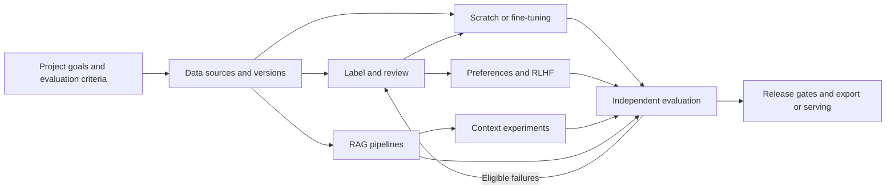
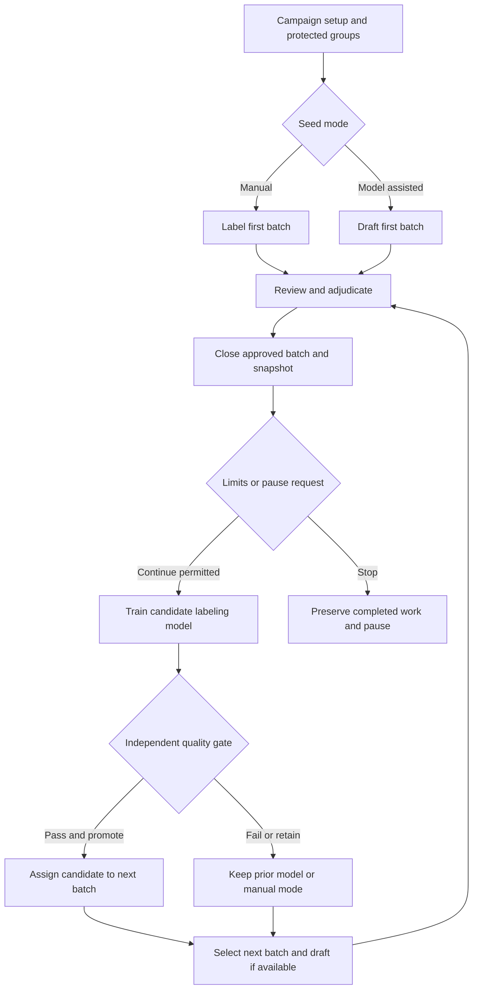

# ModelAnvil Application Flows

Version 0.1 | 8 October 2026 | PRD baseline 0.7 | Status proposed

The application guides teams from a project goal through data, experiments, independent evaluation, and release. Users can enter any qualified workflow directly; they do not have to train a model to build RAG or label data. Every long operation has a durable detail page, current state, ownership, progress, and recovery actions.

## 1 Navigation and shared workspace

The persistent shell contains installation, organization, and project selectors; a global search limited to authorized resources; a job activity drawer; and account/settings access. Project navigation is Overview, Data, Annotation, Models, Training, Evaluation, RAG, Context Lab, Releases, and Infrastructure. Organization settings contain people/teams, grants, policy, storage, integrations, extensions, budgets, and audit access.

| Area | Primary screens | Main actions |
| --- | --- | --- |
| Overview | Goals, workflow history, current runs, readiness | Create workflow, resume work, inspect blockers |
| Data | Sources, Dataset Bank, imports, datasets, versions, preparation | Connect/upload, preview, prepare, split, publish |
| Annotation | Campaign list, setup, batch queue, review, adjudication, cycle dashboard | Label, correct, approve, train labeling model, advance |
| Models | Registry, model version, tokenizer/processor, compatibility | Register, inspect ancestry, baseline, use in recipe |
| Training | Recipe builder, preflight, job detail, run comparison | Pilot, launch, checkpoint, cancel, resume |
| Evaluation | Suites, cases, runs, comparison, failure review | Score, calibrate judge, compare, send eligible failures for review |
| RAG | Knowledge bases, indexes, pipelines, query workbench, cluster explorer | Build, query, trace, evaluate, promote |
| Context Lab | Recipes, input preview, test suites, experiments, comparisons | Compose, replay, ablate, stress test, promote |
| Releases | Candidates, gates, export, endpoint versions | Review evidence, export, promote, rollback |
| Infrastructure | Pools, workers, capacity, job recovery, usage | Connect/drain, inspect, adjust permitted quotas |

Use representative web routes `/orgs/:org/projects/:project/{area}/:resource`. Route identifiers are stable; selected tabs, filters, comparisons, and version IDs are shareable URLs. Access is checked again after navigation. Mac screens open equivalent resource IDs through the same API where supported.

## 2 FLOW 01 Installation onboarding and project setup

**Actor:** organization administrator, then researcher. **Entry:** a managed organization invitation or configured self-hosted installation. **Requirements:** PRJ01, OPS01–OPS03, OPS05–OPS06.

1. Authenticate and select/create an authorized organization. Show installation mode and where metadata/artifacts will live. Join a team and set project access independently of infrastructure roles.
2. Connect authorized object storage and a worker pool; run access/capability probes. Hybrid setup enrolls an outbound worker/gateway, records egress policy, and shows connectivity without displaying secrets.
3. Create project: intended outputs/tasks, languages, baseline, evaluation suites, release criteria, budgets, and available capabilities. Save incomplete setup with named missing prerequisites.
4. Overview offers Start from scratch, Adapt a model, Label data, Build RAG, or Test context. Each option shows prerequisites and resumes its saved configuration.

**Exit:** versioned project configuration and authorized resources. **Recovery:** failed storage/worker probes offer diagnostic details and retry; data-only work can proceed while compute is unavailable. Do not fabricate ready GPU capacity.

## 3 FLOW 02 Acquire data and use the Dataset Bank

**Actor:** data engineer. **Requirements:** DAT01–DAT03, BANK01–BANK07. **Screens:** source chooser → source/preset detail → sample preview → scope/destination → import job → extraction review.

1. Choose local upload, object storage, repository, API, web crawl, or Dataset Bank. Search bank by intended output such as SVG, task, content license, size, access, and readiness.
2. Inspect source revision, license evidence/obligations, splits and evaluation-only roles, measured/unknown sizes, example assets, preparation recipe, and qualified capabilities. Proposed or unqualified sources show why download is unavailable.
3. For SVG starter, choose a bounded sample or full permitted scope, source subset, variant handling, and destination. Share-alike expansions and gated credentials are separate explicit choices where applicable.
4. Preflight validates permission, storage, connector, scope, limits, and expected cost assumptions. Launch creates an import job, then navigate to its durable detail page.
5. Review raw/extracted samples beside original assets. Inspect unsupported constructs, failed records, provenance, notices, and suggested field mapping. Retry failures or exclude with a reason before publishing a usable source snapshot.

**Exit:** complete pinned source snapshot; it may still need preparation for training. **Recovery:** interruption resumes verified parts; cancellation leaves an incomplete job, not a ready dataset. Upstream changes create a new import revision. A catalog source with changed terms is suspended for requalification.

## 4 FLOW 03 Prepare a dataset and custom formats

**Actor:** data engineer/researcher. **Requirements:** DAT04–DAT06, EXT01–EXT02. **Screens:** preparation recipe → preview/diff → mapping → dedup/splits → job → dataset version.

1. Select exact source versions and schema. Map fields without code or select an installed qualified reader/converter. Unknown binary content can be retained while parsing/training remains unavailable.
2. Preview normalization, privacy/quality detection, filters, deduplication, and affected counts on a disclosed sample. Display detector uncertainty and keep/drop reasons.
3. Inspect duplicate/source groups and define group-aware train/validation/test assignments. Block protected benchmark contamination; version any deliberate policy decisions permitted by the project.
4. Configure mixture weights, tokenizer/sharding if applicable, and run preparation. A version detail screen shows schema, counts, distributions, source lineage, failures, split evidence, and hash manifest.
5. Publish the immutable version and choose Label, Train, Build knowledge base, Evaluate, or Export according to capability.

**Recovery:** mapping errors link to source examples; changing a recipe creates a new revision. Installing executable extensions requires an authorized administrator and separate isolation/qualification, not an ordinary mapping action.

## 5 FLOW 04 Iterative labeling

**Actors:** campaign owner, annotator, reviewer/adjudicator. **Requirements:** ANN01–ANN07, SYN02. **Screens:** campaign setup → batch queue → draft/manual editor → review/adjudication → closed batch → cycle dashboard.

1. Define source pool, task schema/rubric, reviewers, batch size, selection policy, audit/validation/final-test groups, model quality gates, and cycle/budget limits. Choose manual seed or existing-model drafts. Preflight checks model-to-label mapping and available independent evidence.
2. Select unused training-eligible examples manually or reproducibly at random. Batch identity fixes source items, schema/rubric, and drafting-model revision. Draft generation is a separately metered job; invalid predictions remain visible and can be labeled manually.
3. Review each item. Save draft, accept without edit, correct, reject, skip, or escalate. Show original prediction and change history; allow hidden-prediction independent audit mode. Keyboard controls and autosave state remain visible.
4. Resolve disagreements and close the batch atomically. Closure shows approved/omitted counts and unresolved blockers. Only approved, valid, nonprotected labels enter the cumulative training snapshot.
5. Train/fine-tune a compatible labeling-model candidate. Compare independent task metrics, slices, class coverage, human effort, and cost against the current model. Insufficient data returns users to manual labeling.
6. Promote the candidate for future batches or keep the previous model/manual mode. Failure never overwrites the current assignment. Select/draft the next batch and repeat.
7. Campaign dashboard shows cycle timeline, approved cumulative count, assigned models, corrections, audits, qualification decisions, and limits. Pause requests active-job cancellation and stops new stages; resume reconciles actual state. Rollback changes future assignments and preserves corrections.

The diagram represents allowed progression; the orchestrator evaluates pause/limit guards before every stage, so no training launches from a paused campaign. Default progression is manual. Bounded automatic train/draft can be enabled by the owner without bypassing label review. R1 qualification requires two train-and-next-batch cycles in each seed mode on one text task.

## 6 FLOW 05 Train from scratch

**Actor:** ML engineer. **Requirements:** TRN01–TRN03, TRN05–TRN07. **Screens:** architecture/recipe → data mixture/tokenizer → baseline/suites → preflight/pilot → run → evaluation.

1. Choose supported scratch architecture and explicit random initialization; pin dataset mixture and splits.
2. Train/import tokenizer, inspect vocabulary, special tokens, language coverage, and sequence lengths. Choose compatible precision/topology and checkpoint policy.
3. Configure optimizer/schedule, token/step budget, validation interval, stopping rules, and protected evaluation suites. Preview input examples and model dimensions.
4. Preflight shows blockers, qualified hardware, total resource group, storage, budget assumptions, and small pilot. Pilot measurements refine estimates; a full run requires an explicit launch.
5. Monitor stage, loss, validation, throughput, usage, and checkpoint status. Cancel/checkpoint/resume actions show actual backend state. Compare runs with changed-input highlights.
6. Evaluate independently, then send a candidate to release review. A completed loss curve does not establish a passing release.

**Recovery:** queue screens explain missing capacity; unknown worker stop becomes interrupted. Resume names the verified checkpoint and supported state restored. Partial checkpoints cannot be selected.

## 7 FLOW 06 Adapt an existing model

**Actor:** ML engineer. **Requirements:** TRN01, TRN04–TRN07, EVA01–EVA04.

Register an exact base model revision and license, verify tokenizer/processor/template, and run a baseline suite. Choose continued pretraining, full SFT, or a qualified adapter recipe; attach a versioned dataset and preview actual encoded samples. Preflight checks adapter/quantization compatibility and resources. Run a pilot or launch, monitor, then compare with the baseline on intended and protected tasks. Exported adapters identify the required base model revision. Unsupported combinations link to the capability matrix and block GPU allocation.

## 8 FLOW 07 Human preferences and alignment

**Actors:** researcher, annotators, evaluation lead. **Requirements:** SYN01, ANN01–ANN03, ALN01–ALN05.

Generate candidate responses on training-eligible prompts, recording model and decoding revisions. Assign randomized blinded comparisons; preserve ties, abstentions, and adjudication. Freeze the approved preference dataset with prompt-group splits. The next screen presents three distinct qualified paths:

| Path | Required stages | Evidence before release |
| --- | --- | --- |
| DPO | Pair construction → direct preference training | Independent comparison and regressions |
| Learned-reward RLHF | Train/validate reward model → select policy/reference → fresh rollouts → reward scoring → policy updates | Held-out human comparison, regressions, reward exploitation checks |
| Verifier-based RL | Select versioned verifier/environment → bounded rollout/update recipe | Independent task evaluation beyond training rewards |

RLHF preflight records resource allocation across rollout, scoring, and update stages, divergence and response-length controls, checkpoint state, and stop limits. Run detail shows raw reward, penalties, objective, divergence, length, policy/value metrics where available, and independent quality. Rising reward with falling independent quality is visible and cannot pass gates. New human feedback creates a new reward version and an explicitly launched iteration.

## 9 FLOW 08 Build and test RAG

**Actors:** application/ML engineer, evaluation lead. **Requirements:** RAG01–RAG08.

1. Choose authorized source versions, inspect extraction, and define chunking with exact source locations and access rules.
2. Select embedding/query encoders and build a knowledge-base/index version. Inspect dimensionality, distance, counts, freshness, failures, and qualified scale.
3. Build lexical, dense, or hybrid pipeline with filters, fusion, top-K, optional reranking, generator, context recipe, citations, and abstention policy.
4. Query in a workbench. Trace inspector separates retrieval candidates, reranked results, actually supplied context, answer/citations, timings, and tokens. Citation opens the exact source revision if still authorized.
5. Import/annotate relevance judgments and expected answers. Compare retrieval metrics, answer scores, judge calibration, uncertainty, latency, and cost separately. Missing judgments show coverage/N/A.
6. Open cluster explorer with saved projection, source/task filters, lasso, query and relevant-evidence overlay. Inspect neighbors in original embedding space and use a table alternative. Send eligible failure selections for review after leakage checks.
7. Qualify pipeline, review release gates, and promote an authenticated query endpoint or export a portable recipe. Updates build new index versions; permission/deletion overlays apply to old versions immediately under the authorization contract.

**Recovery:** partial builds are unavailable; retain last complete index with current authorization. Dimension mismatch blocks build/query. Rollback cannot restore revoked evidence.

## 10 FLOW 09 Context Lab

**Actor:** application/ML engineer. **Requirements:** CTX01–CTX04.

Choose a direct model or RAG pipeline and create a typed recipe: instructions, examples, evidence, history, memory, tool definitions/results, and user input. Set source/trust, order, selection, per-block budget, compression, and reserved output. Compile preview shows exact serialized messages, tokenizer counts, and included/omitted/transformed blocks with provenance.

Select a versioned suite and frozen memory/tool fixtures. Compare one factor at a time or a bounded declared sweep: evidence order/position, length, packing, history window, summarization, memory selection, and block removal. Run no-retrieval, retrieved-context, and gold-evidence diagnostics where appropriate. Multi-turn tests include stale/deleted memory, isolation, tool errors, missing evidence, contradictory sources, injected instructions, and overflow.

Comparison shows task quality versus tokens/cost/latency, evidence retention, block diffs, case failures, and tested lengths. Repeated stochastic runs disclose variance and replay limits. Promote a recipe only after its gates pass, independently or with a model/pipeline; previous qualified recipe versions remain available for rollback.

## 11 FLOW 10 Evaluate release and export

**Actor:** evaluation lead and release publisher. **Requirements:** EVA01–EVA04, REL01–REL02.

Select candidate and baseline versions, frozen suites, decoding/hardware protocol, and required slices. Run deterministic and calibrated judge/human checks. Compare failures, uncertainty, missing cases, and contamination reports. A gate review freezes exact evidence and rules; incomplete/failing required checks block promotion. Only an authorized publisher can record a policy-permitted exception with reason and scope.

Choose model/adapter export, supported endpoint, RAG pipeline, or context recipe release. Export includes applicable assets, manifest hashes, model card, license/attribution evidence, and required dependencies. Quantized candidates receive post-conversion evaluation. Show external loading result or serving readiness before marking ready. Endpoint promotion names the old/new release and rollback target; rollback rechecks compatibility and current access policy.

## 12 FLOW 11 Operations and hybrid recovery

**Actor:** infrastructure operator with separately controlled content access. **Requirements:** OPS02–OPS07.

Pool view shows compatible capacity, free/allocated slots, queue age, starvation, drain, and usage. Job detail distinguishes queued, claimed, running, interrupted, cancellation requested, actually stopped, and resources released. Operators inspect backend allocation and lease/fence history before retrying an abandoned chargeable attempt. Drain stops new claims and lets configured active work finish/checkpoint. Hybrid disconnection retains durable state and blocks unsafe duplicate restart; reconnect reconciles actual execution and scoped credentials.

## 13 Shared interaction and state rules

Every screen defines loading, empty, partial, permission-denied, validation-error, stale-revision, network-disconnected, and complete states. Empty views offer the next authorized prerequisite action. Permission-denied views do not disclose concealed object names. Partial results show missing counts and never masquerade as a complete evaluation.

Configuration forms save a draft; launching freezes a revision. Back navigation preserves form state. Label autosave displays Saving/Saved/Conflict/Offline locally, and unresolved offline edits cannot be approved or train a model. Optimistic UI is limited to reversible draft work; actual compute start, model promotion, and release completion wait for server confirmation.

Each job carries a return link to its originating flow. Global activity supports background work and reconnect. Users can leave a page without cancelling a job. Bulk actions show selected scope and capability; exports/publication or chargeable launches receive a concrete review screen with estimated/unknown usage and applicable policy. This is product confirmation, not an extra approval imposed on every reversible action.

Mac R1 coverage is proposed as authentication/installation selection, project and dataset browsing, local resumable upload, annotation/review, run monitoring/cancellation, evaluation inspection, and export/download. Advanced builders and WebGL exploration may open the authorized browser route. Product review must settle this matrix in WP-01; no full parity is implied.

## 14 FLOW 12 Compose and rerun a workflow

**Actor:** researcher/data engineer with permission for each stage. **Requirements:** PRJ02–PRJ03, API01. **Screens:** workflow list → composer → node inspector → preflight → workflow run timeline.

Choose a template or add typed processing, annotation, training, evaluation, and packaging nodes. Connect compatible output/input ports, pin resource/recipe versions, and define permitted stop/gate conditions. A canvas and equivalent structured list show prerequisites; the node inspector exposes full configuration and artifact references. Validate cycles, missing inputs, incompatible schemas, permissions, resource needs, and budget before launch.

The run timeline links each node to its job, committed outputs, failures, and human-review prerequisites. Retry a failed node or rerun a changed workflow revision. Reuse a completed node only when exact input/configuration digests match and current permissions permit it; downstream changed nodes rerun. Manual review nodes wait for actual authorized approval. Saving or changing the template cannot mutate an already launched graph. Export/import preserves the same graph for API/CLI automation.

## 15 Flow acceptance handoff

UX prototypes must exercise FLOW-02 SVG acquisition, FLOW-04 both labeling seeds including a failed candidate, FLOW-05 scratch launch/recovery, FLOW-07 complete RLHF, FLOW-08 query/trace/failure investigation, FLOW-09 context comparison, and FLOW-10 a failing release gate. Include keyboard-only review, lost connectivity, stale permissions, inadequate data, and unavailable compute. Engineering scenarios in the PRD remain the release authority.
