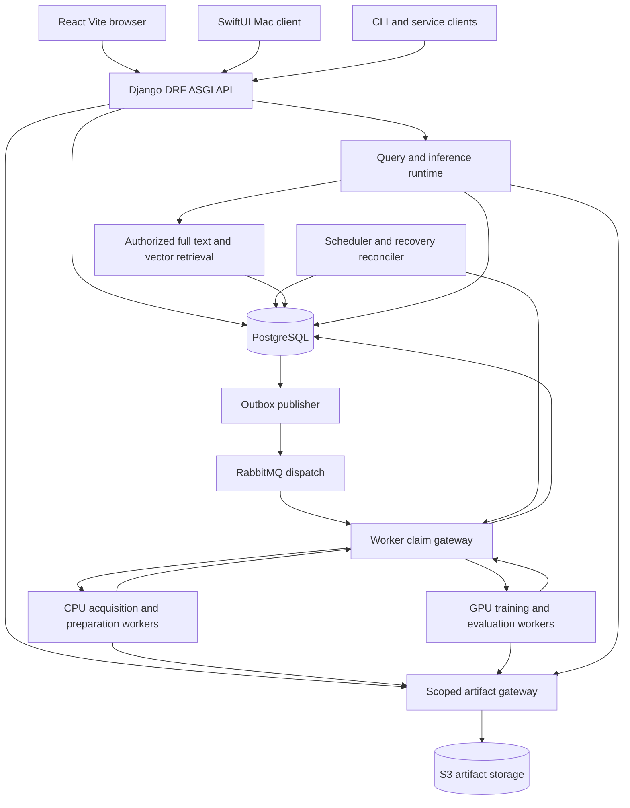
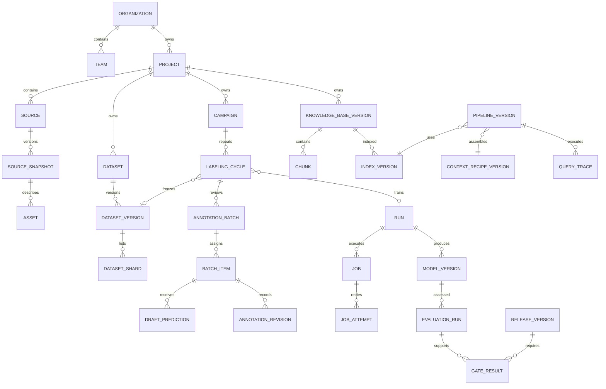

# ModelAnvil Backend Architecture and Data Schema

Version 0.1 | 8 October 2026 | PRD baseline 0.7 | Status proposed logical schema

The backend separates durable control-plane state from large immutable artifacts and isolated execution. PostgreSQL owns identity scopes, version references, workflow state, annotation revisions, qualification decisions, and usage. S3-compatible storage owns payloads and manifests. RabbitMQ wakes eligible workers; it is not the job history database.

This document defines relational entities, field types, relationships, lifecycle rules, and critical transactions. It is the input to Django models and reviewed migrations, not an already applied migration. JSON schemas in this pack define two initial interchange contracts; task payloads and individual adapter protocols need further versioned contracts during implementation.

## 1 Service and process architecture

API, outbox, and reconciler can share the same application codebase with separate entry points. Worker executors and query serving have independent images/resources. Hybrid workers connect outward through the scoped gateway; they do not require public broker or database access. Artifact residency and permitted metadata egress are installation configuration, not an inference from worker location.

Proposed Django modules: `identity`, `projects`, `artifacts`, `sources`, `datasets`, `annotation`, `registry`, `workflows`, `compute`, `alignment`, `evaluation`, `retrieval`, `context`, `releases`, `usage`, and `audit`. Domain modules own state transitions; serializers cannot mutate authoritative lifecycle fields freely.

## 2 Schema conventions

Primary keys are UUIDs. All business timestamps are `timestamptz`. Counts and byte sizes are `bigint`; ratios use bounded numeric or double precision as appropriate; currency/price uses decimal plus currency/unit. Configurable enums are checked text fields with migration-controlled values. JSONB stores validated variable configuration, not essential foreign keys hidden from integrity checks. Large row sets use manifests/shards and paginated indexes.

Project domain tables share `id`, `org_id`, `project_id`, `created_at`, `created_by`, and, for mutable records, `updated_at` and `lock_version bigint`. Revision rows add `revision_no`, `schema_version`, `content_digest`, and immutable publication time. `NULL` is explicit absence; unavailable/failed/undefined metrics use a separate status and reason, not a fabricated zero.

Use an owned `resource` row for each top-level object and revision that needs grants/lineage. `resource(id, org_id, project_id nullable, kind, created_at)` is the scope anchor; domain tables use `resource_id` as their primary key. Child rows inherit scope from a concrete parent and carry scope columns for enforcement/querying. The dictionary uses `id` as shorthand for each entity's key. Public catalog rows live outside tenant tables; imports into a project receive owned IDs.

Enforce parent scope with database constraints: unique referenced `(org_id, project_id, id)` tuples and composite foreign keys or reviewed constraint triggers where the ORM cannot express the relationship. Application authorization remains mandatory. No nullable-project shortcut can link a project row to another tenant. Optional row-level security is defense in depth to qualify with connection pooling; it is not assumed operational.

Immutable versions cannot be edited in place after publication. Corrections create revisions. Mutable policy overlays, tombstones, grants, and retention status apply to old versions. Foreign keys use RESTRICT by default for referenced published data; deletion runs through audited lifecycle operations. User removal preserves required pseudonymous audit attribution under retention policy.

## 3 Main entity relationships

The ERD is a navigation overview. The dictionary below adds membership/grants, sharing, manifests, evaluation evidence, sessions, usage, and runtime allocations. Campaign cycles can aggregate more than one review batch; the first supported UI can use one primary batch per cycle.

## 4 Identity and project dictionary

| Table | Essential fields beyond its key | Relationships and integrity |
| --- | --- | --- |
| organization | name, slug, deployment_mode, policy_revision_id | Unique installation slug |
| principal | kind user/service/worker, identity_subject, identity_provider, disabled_at | Unique provider/subject; no application password assumption |
| organization_membership | org_id, principal_id, role_id, status | Unique org/principal; explicit active state |
| team | org_id, name | Unique org/name |
| team_membership | team_id, principal_id | Parent organization membership required |
| project | org_id, name, slug, owning_team_id, current_config_id | Unique org/slug; owning team in same org |
| project_config_revision | project_id, revision_no, tasks/languages JSONB, baseline_ref, budget_policy_id, release_policy_id | Immutable published configuration; pin per run |
| role / role_permission | org_id, role name; role_id, action, resource_kind | No implicit data grant from worker administration |
| access_grant | resource_id, grantee principal/team, action, expires_at, revoked_at | Exactly one grantee kind; explicit cross-project share |
| credential_reference | owner principal/org, provider, secret_locator, scope, expires_at, revoked_at | Secret locator only; plaintext secrets outside database payloads |
| policy_revision | org_id, kind, revision_no, validated rules JSONB | Data egress, retention, source, budget, release policies |
| audit_event | org_id, project_id nullable, actor_id, action, resource_id, request_id, occurred_at, detail_ref | Append-only within retention; sensitive detail is scoped |
| idempotency_record | org_id, principal_id, operation_key, client_key, request_digest, response_ref, created_at, expires_at | Unique scoped operation/client key; changed digest conflicts |

Cross-organization transfer creates a destination-owned import and records source publication/authorization evidence; ordinary grants do not silently cross tenant boundaries.

## 5 Artifact source and dataset dictionary

| Table | Essential fields | Relationships and integrity |
| --- | --- | --- |
| artifact | scope, storage_location_id, object_key, object_version nullable, sha256, byte_size, media_type, state, committed_at, tombstoned_at | Unique tenant/storage/key/version; verified before committed |
| artifact_manifest | artifact_id, manifest_schema, entry_count, digest | Manifest itself checksummed; entries can be in shards |
| lineage_edge | parent_resource_id, child_resource_id, relation, producing_run_id nullable | Typed allowed edges; same scope or explicit import/share provenance |
| storage_location | org_id, provider_kind, endpoint_ref, bucket, region, residency, credential_ref | No secrets in URI; qualification record required |
| transfer_session | scope, direction, source_ref, staging_prefix, multipart_ref, state, bytes_verified, expires_at | Complete/abort idempotent; part manifest retained for resume |
| source | scope, kind, connector_revision_id, configuration_ref, credential_ref nullable | Mutable display/config pointer; exact config frozen in snapshot |
| source_snapshot | source_id, revision_no, upstream_revision, acquisition_job_id, raw_manifest_id, license_evidence_id, state | Immutable upstream identity/hash, counts, errors, acquisition time |
| asset | scope, snapshot_id, artifact_id, source_uri, location JSONB, metadata JSONB | Source page/time/path provenance; raw byte reference |
| schema_definition_revision | scope, name, revision_no, json_schema_artifact_id, digest | Versioned sample/label/task/rubric definitions |
| preparation_recipe_revision | scope, schema_id, ordered_steps JSONB, adapter_refs, split_policy_ref, digest | Every executable step pins environment/adapter |
| dataset | scope, name, current_published_version_id nullable | Pointer cannot mutate historical versions |
| dataset_version | dataset_id, revision_no, schema_id, manifest_id, producing_run_id, recipe_id, split_report_id, stats_ref, state | Unique dataset/revision; ready only with complete verified shards |
| dataset_shard | dataset_version_id, ordinal, artifact_id, record_count, split_role | Unique version/ordinal; manifest order fixed |
| sample_locator | dataset_version_id, sample_id UUID, shard_id, row_locator, source_group_id, source_resource_id | Sparse/projected lookup; unique version/sample; full payload lives in shard |
| split_assignment_manifest | dataset_version_id, artifact_id, method, seed nullable, grouping_revision, overlap_report_id | Group membership fixed; roles train/validation/audit/test explicit |
| dataset_mixture_revision | scope, components JSONB with version IDs/weights, seed, sampling_recipe | Validated references also represented in lineage/typed input links |
| catalog_source_revision | catalog namespace, source_key, revision_no, pinned_upstream, license refs, access/readiness, connector_ref | Public or org-private catalog; no tenant secrets |
| catalog_preset_revision | namespace, preset_key, revision_no, member_revision_ids, preparation_recipe, limits | Fixed source revisions; explicit expansion/policy options |
| license_evidence | namespace/scope, source_url, license_identifier/expression, notice_artifact, inspected_revision, reviewed_at, eligibility | Source and model licenses assessed separately; unknown blocks download eligibility |

`sample_locator` supports interactive lookup and assignments without forcing all corpus tokens into PostgreSQL. Use sharded sample indexes for bulk resolution and materialize needed rows for review. Its sample identity is stable within a declared source-record lineage; transformed content receives a revision/derived identity. Cross-version aliasing must be explicit and cannot bypass split checks.

## 6 Annotation and iterative labeling dictionary

| Table | Essential fields | Relationships and integrity |
| --- | --- | --- |
| campaign | scope, label_schema_id, rubric_id, source_version_id, seed_mode, policy_revision_id, current_assignment_id, state, desired_action | Version/schema changes require explicit migration |
| campaign_protected_group | campaign_id, group_id, role validation/audit/test, assignment_manifest_id | Unique campaign/group; excluded from training and target selection |
| labeling_cycle | campaign_id, cycle_no, approved_dataset_version_id nullable, training_run_id nullable, qualification_run_id nullable, decision_id nullable, state | Unique campaign/cycle; complete requires snapshot and next-model decision |
| annotation_batch | cycle_id, selection_manifest_id, selection_method, seed nullable, draft_assignment_id nullable, state, closed_at, lock_version | Items and model/rubric pinned; closure unique/idempotent |
| batch_item | batch_id, sample_locator_id, assignment_group, state, active_revision_id nullable | Unique batch/sample; protected groups denied |
| review_assignment | batch_item_id, reviewer_id, task_role, expires_at, state, blind_order_ref | Authorized scope; overlap intentional and reproducible |
| draft_prediction | batch_item_id, prediction_revision, model_assignment_id, prediction_job_id, payload_ref, score nullable, score_kind, calibration_ref, validation_state | Append-only; unique item/prediction revision |
| annotation_revision | batch_item_id, revision_no, author_id, predecessor_id nullable, draft_prediction_id nullable, origin, action, payload_ref, review_state, rubric_id, duration_ms nullable | Human authorship and model-assisted origin separate; history immutable |
| adjudication | batch_item_id, input_revision_ids, adjudicator_id, resolved_revision_id, reason | Preserves disagreement and resolution; resolved label valid |
| approved_label_member | approved_dataset_version_id, sample_locator_id, annotation_revision_id, group_id | Exact approved revision; unique snapshot/sample; no unresolved/test cases |
| labeling_model_assignment | campaign_id, model_version_id nullable, prompt/context_ref nullable, label_mapping_ref, rubric_id, assigned_at, decision_id | Null model denotes manual mode; batches point to fixed assignment |
| candidate_decision | cycle_id, candidate_model_id nullable, prior_assignment_id, evaluation_run_id nullable, result promote/retain/manual, actor_id, reason, gate_policy_id | Default manual advance; failing candidate cannot silently promote |
| campaign_cycle_metric | cycle_id, metric_key, slice_ref, value nullable, status/reason, count, evidence_ref | Independent audit and assisted-review metrics labeled separately |

Approved-label membership is a normalized index for reviewed training subsets, not the entire raw corpus. Snapshot building freezes specific annotation revision IDs and source-group evidence. Later correction creates a new cumulative version; completed training stays pinned to its prior snapshot. A model-origin label accepted unchanged keeps `origin=model_assisted` and the original `draft_prediction_id`.

Concurrent edits use `lock_version`/If-Match on the current item/assignment. A conflict returns the competing revision and preserves the user's unsent draft. Batch closure locks the batch, verifies outstanding assignments/adjudications, writes the final approved membership and cycle trigger in one transaction, and uses a unique `(batch_id, trigger_kind)` key. Retry cannot start a second cycle train.

## 7 Models workflow compute and alignment dictionary

| Table | Essential fields | Relationships and integrity |
| --- | --- | --- |
| model | scope, name, intended_tasks | Logical registry entry |
| model_version | model_id, revision_no, architecture_ref, artifact_manifest_id, tokenizer_id, processor_id nullable, license_evidence_id, producing_run_id nullable | Immutable; base/parent relationships in typed lineage |
| tokenizer_version / processor_version | scope, artifact_manifest_id, configuration_digest, compatibility_ref | Pinned with model/recipe |
| adapter_revision | namespace/scope, name, version, manifest_id, image_digest, conformance_report_id | Capability claims require qualification |
| capability_qualification | adapter_revision_id, exact_combination_ref, status, report_id, hardware_ref, reviewed_at, limitations | Qualified combinations, not global library support |
| recipe_revision | scope, kind, schema_id, config_artifact_id, adapter_revision_id, environment_digest | Scratch/SFT/DPO/reward/RLHF/verifier/etc.; validated and immutable |
| workflow_revision / workflow_node / workflow_edge | scope, graph_digest; workflow_id, node_key, recipe_ref; from/to node/port | Unique node key, DAG validation, typed inputs/outputs |
| run | scope, kind, project_config_id, recipe_id, workflow_id nullable, input_digest, state, launched_by | A domain experiment with one or more jobs |
| run_input | run_id, role, resource_version_id, ordinal | Typed version references; unique role/ordinal |
| job | run_id, node_key, capability, input_digest, state, desired_action, priority, eligible_at, active_attempt_id nullable, next_fence, budget_reservation_id | Stable job identity; monotonic fence; one active attempt |
| job_dependency | parent_job_id, child_job_id, required_output_role | No cycles; child eligibility after committed parent output |
| job_attempt | job_id, attempt_no, fence_token, worker/allocation_id, lease_until, backend_execution_id, observed_state, started/stopped timestamps | Unique job/attempt and job/fence; partial unique active attempt |
| job_output | job_id, role, artifact_id/resource_version_id, attempt_id, input_digest | Exactly one output kind; unique job/role for final commit |
| checkpoint | run_id, attempt_id, step, manifest_id, state, restored_state_capabilities, verified_at | Only verified complete checkpoints are resumable |
| outbox_event | org_id, aggregate_id, event_key, schema_version, payload, created_at, published_at, retries | Unique event_key; retry after publish ambiguity is safe |
| inbox_receipt | consumer_key, event_id, processed_at, result_ref | Unique consumer/event for domain side effects |
| domain_trigger | parent_resource_id, trigger_kind, policy_revision_id, child_job_id nullable, status | Unique parent/trigger kind; cycle closure cannot launch twice |
| job_event | job_id, sequence_no, event_id, kind, scoped_payload_ref, occurred_at, expires_at | Unique job/sequence; authorized resumable observation, retention-aware cursor |
| worker_pool / worker | org_id, execution_adapter_ref, policy; pool_id, identity_id, capabilities_ref, heartbeat_at, drain_state | Enrollment/revocation and declared resource scope |
| resource_allocation / allocation_member | job_id, fence, state, backend_group_ref; allocation_id, worker/node_ref, slots, GPU/memory resources | Full resource group reserved atomically before launch |
| metric_series | run_id, attempt_id, metric_key, unit, shard_manifest_id | Dense series in artifact shards; metadata/query summaries in DB |
| preference_item / preference_judgment | prompt/sample/group, candidate_refs; item_id, annotation_revision_id, ordering/tie/abstention | Blind presentation order distinct from true candidate identity |
| reward_model_evidence | model_version_id, preference_dataset_id, validation_run_id, score_distribution_ref | Reward validation distinct from policy release evidence |
| alignment_run_config | run_id, algorithm_ref, policy_id, reference_id nullable, reward_model_id/verifier_ref, prompt_dataset_id, rollout/update limits, divergence_config | Exactly the qualified recipe's required components |
| rollout_manifest | run_id, iteration_no, policy_revision/digest, trajectories_artifact, scoring_config, checkpoint_id | Fresh-rollout provenance, reward components and resource use |

## 8 Evaluation RAG context and release dictionary

| Table | Essential fields | Relationships and integrity |
| --- | --- | --- |
| evaluation_suite_version | scope, case_manifest_id, schema_id, scorer_ref, judge_config_ref nullable, protected_role | Exact cases/scorers and contamination report |
| evaluation_run | scope, suite_id, candidate_version_id, baseline_id nullable, protocol_ref, job_id/run_id, status | Candidate type explicit: model/pipeline/context |
| evaluation_case_result | evaluation_run_id, case_id, output_ref, status, failure_reason, trace_ref nullable | Unique run/case/sample repetition |
| evaluation_metric | evaluation_run_id, case_id nullable, key, cutoff nullable, slice_ref, value nullable, metric_status, sample_count, uncertainty_ref | Undefined/missing/failed distinct; denominator recorded |
| judge_calibration | judge_model_id, prompt_ref, human_sample_ref, evaluator_ref, agreement_report_id | Versioned qualification evidence |
| knowledge_base / knowledge_base_version | scope, name; kb_id, source/dataset refs, chunk_recipe_ref, chunk_manifest_id, state | Complete version snapshot; source references in typed inputs |
| chunk | kb_version_id, evidence_id, source_resource_id, content_artifact/span, source_location, hash, permission_resource_id | Unique version/evidence; locations map exact source revision |
| embedding_space / embedding_set | model/encoder revision, dimension, normalization, distance; space_id, kb_version_id, vector_manifest_id, state | No incompatible encoder/dimension mixing |
| chunk_vector | embedding_set_id, chunk_id, vector typed for qualified dimension | Unique set/chunk; physical table/index per compatible profile |
| index_version | kb_version_id, embedding_set_id nullable, backend_config_ref, lexical_config_ref, build_manifest, state, built_at | Full-text-only indexes may omit embedding set |
| retrieval_pipeline / pipeline_version | scope, name; pipeline_id, index_id, retriever/fusion/reranker refs, filters, generator_id, context_recipe_id, citation/abstention rules | Frozen end-to-end configuration |
| relevance_judgment | suite_id, query_id, evidence_unit_type, evidence_id/source_span, grade, origin, review_ref, mapping_version | Unit and mapping explicit; unique judgment revision |
| query_trace | scope, pipeline_id, principal/session_ref, input/output artifacts, stage_manifest, timing/token refs, retention_until, policy_epoch | Actual supplied context stored separately from all candidates |
| projection | scope, embedding_set_id, method, parameters, seed nullable, coordinates_manifest, selection/sampling_ref | Saved coordinates; input space and sampling disclosed |
| cluster_assignment | projection_id, method, clustering_space_ref, parameters, labels_manifest | Optional; no silent clustering of display coordinates |
| saved_evidence_selection | scope, projection_id nullable, evidence_ids_manifest, filters, query_ref nullable | Reauthorized on read/export/annotation conversion |
| context_recipe_version | scope, revision_no, block_manifest_id, tokenizer/template_ref, model_limit, output_reserve, budget_policy | Blocks versioned and order fixed |
| context_block_revision | recipe_id, block_key, type, source_ref, trust, order, selection/transform config, budget | Exact before/after lineage recorded during compilation |
| context_experiment | scope, candidate_recipe_ids, suite_id, model_id, corpus_id nullable, tool_fixture_id, memory_snapshot_id, decoding_ref, sweep_manifest | Paired controlled changes and repeated samples |
| session / memory_snapshot | scope, principal_id, session_key, retention; session_id, revision, entry_manifest, created_at | Session scope cannot be shared accidentally |
| memory_entry_overlay | session_id, entry_id, source_resource_id nullable, state, expires_at, policy_epoch | Current deletion/expiry applied to old snapshots |
| tool_fixture_version | scope, schemas_manifest, result_manifest, execution_mode frozen/live, permissions | Bounded authorized live execution distinct from replay |
| context_compilation | trace/experiment_id, recipe_id, serialized_input_artifact, block_mapping_manifest, counts, output_reserve, omitted_reason_ref | Exact observable supplied input; no private reasoning requirement |
| authorization_overlay / deletion_tombstone | org_id, resource_id, principal/grant scope nullable, policy_epoch, effective_at, reason | Current policy takes precedence over immutable history |
| release / release_version | scope, name; release_id, candidate_ref, manifest_id, release_policy_id, status | Model/pipeline/context kinds explicit |
| gate_result | release_version_id, criterion_key, evaluation_run_id, result, evidence_digest, checked_at | Frozen rules/evidence; unique release/criterion |
| release_exception | gate_result_id, actor_id, permitted_policy_id, reason, expires_at nullable | Only where configured policy permits |
| endpoint / deployment_revision | scope, endpoint_key, active_deployment_id; endpoint_id, release_version_id, serving_config, readiness, previous_id | Atomic pointer promotion; current authorization rechecked on rollback |

For huge corpora, chunk payload and embedding matrices stay in sharded artifacts; the retrieval database contains the subset/index needed to serve the qualified profile. Separate retrieval PostgreSQL from the control-plane database when measured isolation or capacity requires it. Physical partitioning follows qualified query patterns, not one arbitrary table per user.

## 9 Usage and budget dictionary

| Table | Essential fields | Integrity |
| --- | --- | --- |
| budget_policy_revision | org/project/team scope, period, unit limits, currency, stop behavior, grace policy | Explicit hierarchy and precedence |
| budget_reservation | job_id, policy_id, estimated_amount/unit, state, settled_amount | Atomic admission; unknown costs require configured bounds |
| usage_event | scope, job/attempt/query ref, provider_event_key, quantity, unit, rate_revision, occurred_at, observed_at | Unique provider/source event key; late usage disclosed |
| rate_revision | provider/resource kind, unit price, currency, effective range, source | Estimates and measured provider charges distinct |
| usage_adjustment | usage_event_id, amount_delta, reason, source_event_key | Append-only reconciliation; no silent historical overwrites |

Storage usage is measured under a declared logical/physical accounting policy. Training and draft predictions are separately attributed. Budget stop requests must still reconcile backend completion and delayed provider bills.

## 10 Critical database transactions

**Create job:** lock applicable budget counters, validate current access and versions, reserve bounded usage, insert run/job/dependencies, and insert unique outbox event. Commit before publication. A request idempotency record returns the same job on repeated mutation.

**Claim attempt:** lock the eligible job and allocation records in deterministic order. Reject an existing live attempt or incompatible/draining worker. Reserve the complete resource group and create attempt with `fence_token=next_fence`, increment the fence, set active attempt and server-time lease, and commit. Distributed allocation must not reserve unrelated fragments without a complete launchable group.

**Heartbeat:** conditional update requires matching job/attempt/fence, active observed state, nonrevoked worker, and lease policy. A heartbeat cannot revive a revoked fence. Progress payloads have bounded size and sequence IDs.

**Commit output:** verify staged manifests, then lock job/attempt and recheck current fence, lease validity, input digest, authority, and expected output set. Insert committed outputs, finalize observed state, settle usage, and write dependency events in one transaction. A unique output role and attempt result digest make retries idempotent; conflicting duplicate results fail visibly.

**Recover abandoned attempt:** persist interrupted state, query/revoke execution backend, confirm stop and release, then create retry eligibility with a new fence. If stop is unknown, keep interrupted and require operator resolution. Stale output can remain quarantined in staging but cannot become a published result.

**Close annotation batch:** lock batch and cycle, validate exact approved revisions and protected groups, write membership/snapshot request and one closure trigger. Snapshot publication happens only after manifest commit; training eligibility requires published snapshot. No unresolved human revision is silently included.

**Promote labeling model/release:** lock active assignment/endpoint, compare expected revision, verify frozen applicable gates and current access, write decision/deployment revision and pointer change atomically. Existing batch assignment remains unchanged. Rollback creates a new decision/deployment record, not deletion of prior history.

**Revoke evidence:** update current authorization/tombstone and policy epoch transactionally. Query/context/trace/export paths reauthorize against current epoch before exposing payload; cached results with old epochs fail closed. Reindexing and physical deletion follow asynchronously. Previously delivered/downloaded bytes cannot be recalled; in-flight response policy and privileged compute access are separately disclosed.

## 11 Constraints indexes and migration approach

Required uniqueness includes dataset/revision, model/revision, job/attempt, job/fence, one live attempt per job, job/output-role, campaign/cycle, batch/sample, item/prediction-revision, item/annotation-revision, consumer/event, closure/trigger-kind, run/case/repetition, and usage source/event. Check counts/sizes/budgets are nonnegative and valid state combinations hold. Cross-row prerequisites use transactional locks/service guards plus reviewed database constraints where appropriate.

Use indexes on `(org_id, project_id, created_at, id)` for resource lists; `(state, eligible_at, priority)` for dispatch; active lease deadlines for recovery; unpublished outbox times; batch review state/assignee; source groups/split roles; query trace retention; and exact version references. Selectivity and explain plans must be measured. Avoid unbounded JSONB GIN indexes on every configuration field.

Django exposes check and conditional uniqueness constraints; some cross-table/scope enforcement needs explicit PostgreSQL migrations and conformance tests. [Django constraint reference](https://docs.djangoproject.com/en/5.2/ref/models/constraints/). The schema uses those mechanisms as candidates; it does not assume ORM model validation alone prevents concurrent writes.

Migrations use expand → backfill → validate → switch readers/writers → contract. Keep API/worker compatibility for the declared rollout window, test from the previous supported release, and back up before destructive migration. Large vector/index builds and corpus backfills are jobs, not long blocking deploy migrations. Restore fixtures verify both metadata references and artifact availability.

## 12 Artifact layout and canonical sample

Use opaque internal paths scoped to tenant/project, for example `org/{org}/project/{project}/staging/{attempt}/...` and `org/{org}/project/{project}/artifacts/{artifact_id}/...`. Digests are manifest metadata. Commit state in PostgreSQL; objects may already exist at their immutable keys while remaining invisible until committed. Workers cannot list unrelated prefixes.

Dataset manifests list shard IDs/digests, schema, source snapshots, row counts, split assignments, preparation revisions, and license notices. Model manifests list weights/adapters, exact base, tokenizer/processor, configuration, environment, checkpoints, and loading evidence. Index/projection manifests list embedding space, IDs, settings, permissions references, and saved outputs. Project bundles omit credentials and report unavailable/restricted dependencies on import.

The [sample envelope schema](schemas/sample-envelope.schema.json) defines ordered typed blocks with conversation roles, asset references, source locations, grouping, and metadata. Labels remain external annotation revisions until an approved snapshot materializes them. A payload that passes the envelope still requires its task-specific validator and model/processor converter before training. The [adapter manifest](schemas/adapter-manifest.schema.json) is a declaration, not an execution permission or support certification.

Semantic validation additionally checks unique block IDs, valid source/asset references and scope, start/end ordering, coordinate dimensions/ranges, sample/group lineage, matching task schema, payload size/depth limits, and content digest calculation under the declared canonicalization. JSON Schema format validation is enabled explicitly. Manifest permissions are requests intersected with organization/job grants; they never grant access by themselves.
