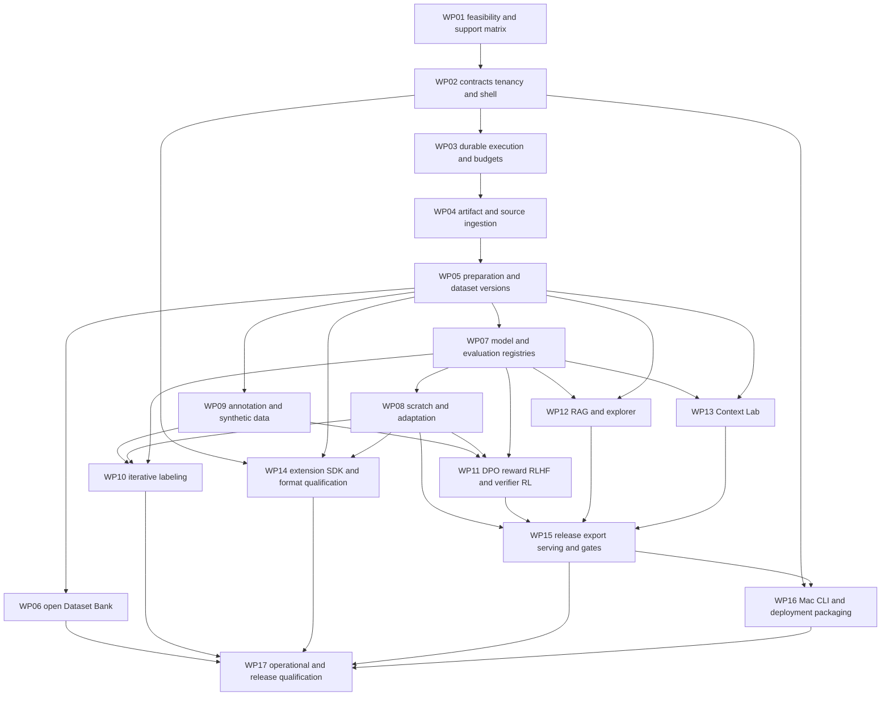

# ModelAnvil Implementation Plan

Version 0.1 | 8 October 2026 | PRD baseline 0.7 | Status proposed dependency and delivery plan

Implement shared platform contracts first, prove both scratch and fine-tuning paths early, then add collaboration/alignment, RAG/context workbenches, and release/operations qualification. The first complete release must satisfy all R1 requirements and all 17 PRD acceptance scenarios. Development increments below are not independent claims of complete product support.

No calendar, cost, or staffing commitment is approved. Work packages have proposed owner roles, dependencies, concrete deliverables, and exit evidence. Estimate them after the feasibility gate names the hardware, engines, workload limits, and available team.

## 1 Delivery structure and repository proposal

Keep one repository with clear packages and separately built runtime images. Begin with a modular backend and extract services only when ownership, performance, or deployment needs justify it.

```text
apps/web/                    React TypeScript Vite workspace
apps/macos/                  SwiftUI client
services/api/                Django modules and migrations
services/worker/             Executor, claim client, adapter runtime
services/query/              Interactive retrieval/inference runtime
packages/contracts/          OpenAPI, JSON schemas, event contracts
packages/sdk-python/         API and extension SDK
packages/ui/                 Web design tokens and reusable components
adapters/                    Qualified provider/task integrations
catalog/                     Dataset source and preset manifests
infra/compose/               Local and single-server reference
infra/helm/                  Multi-node production reference
tests/conformance/           Adapter, storage, worker, format contracts
tests/acceptance/             PRD end-to-end qualification
docs/engineering/            This planning pack
```

The tree is proposed; existing planning files/catalog are preserved. Create application scaffolding in WP-02 after WP-01 settles basic integration/runtime constraints. Avoid building placeholder services that imply a working training pipeline.

## 2 Dependency graph



Interfaces and prototypes can begin before dependencies finish; integration acceptance waits for the listed contracts. Context Lab supports direct-model experiments and need not wait for completed RAG. Mac/CLI scaffolding and packaging begin early alongside the shared API; WP-16 closes their complete evidence after workflows exist.

## 3 Work packages

### WP 01 Feasibility and initial compatibility matrix

**Owner:** engineering lead with ML/platform/design leads. **Dependencies:** PRD and this pack. **Contracts:** all TECH requirements inform qualification scope.

Select reference GPU, two-node topology, model sizes, text architecture, scratch/SFT/adapter engines, learned-reward RLHF algorithm, verifier recipe, inference runtime, embedding/reranker/generator/judge models, and one text-labeling task. Pin versions, licenses, images, and local self-hosted paths. Qualify small engine-level spikes for checkpoint restoration, export/loading, SeaweedFS/managed S3 operations, Scrapling crawl recovery, pgvector filtered retrieval, and annotation prediction/review round trip. These spikes inform adapters; they do not replace platform end-to-end acceptance.

Set provisional workload envelopes, identity approach, Mac feature matrix, egress/retention policy, and design prototype priorities. Assess dependency/platform licensing and offline provisioning. Produce benchmark notes, support matrix, decision records, initial threat/trust boundaries, and measured work-package estimates.

**Exit:** named feasible combinations for required paths, known gaps and fallback adapters, qualification fixtures, and a reviewed support matrix. A missing required recipe blocks commitment to its support claim, not unrelated contract/design work.

### WP 02 Contracts tenancy and shared application shell

**Owner:** backend and frontend leads. **Depends on:** WP-01. **Contracts:** TECH-001–004.

Create monorepo/tooling, CI, backend modular skeleton, shared web shell, auth integration, organization/team/project membership, explicit grants/actions, and project configuration revisions. Publish initial OpenAPI, structured errors, pagination, revision conditions, idempotency records, event stream contract, and generated client types. Define canonical sample/artifact/adapter schemas and contract versioning.

**Exit:** two organizations cannot list/read/mutate each other's resources through API, search, events, or client routes; project setup persists versioned goals; browser smoke journey and contract client work. No compute execution claim yet.

### WP 03 Durable execution compute admission and usage

**Owner:** platform lead. **Depends on:** WP-02. **Contracts:** TECH-003, TECH-017, TECH-030–032.

Implement workflows, jobs/dependencies, outbox publisher, RabbitMQ notification adapter, atomic claims, leases/fencing, worker enrollment/capabilities/drain, complete resource-group reservations, retry/quarantine, checkpoint metadata, observed-versus-desired cancellation, and backend reconciliation. Add a workflow composer with a structured-list alternative, typed ports, node inspector, frozen versions, run timeline, and safe node reuse/retry. Add scoped credentials/artifact access hooks, idempotent usage events, budget reservations, and cost/usage views.

**Exit:** no duplicate chargeable attempt or stale commit during injected duplicate messages, broker restart, worker loss, lease expiry, drain, cancellation, or unknown stop. Full-group reservation and fair team limits pass controlled fixtures. Replayable job history survives API/broker restart.

### WP 04 Artifact storage and source ingestion

**Owner:** data/platform engineers. **Depends on:** WP-03. **Contracts:** TECH-005–007, TECH-029.

Implement S3 storage contract, staging/commit verification, resumable transfers, source snapshots, asset metadata, current-access gateway, and tombstone hooks. Connect local upload, object storage, one repository/API source, and Scrapling with durable crawl checkpoints and explicit limits. Isolate HTML/SVG/document rendering and media decoding. Preserve raw assets and extraction locations/failures.

**Exit:** identical pinned imports match manifests; interrupted transfers resume; cancellation/corruption cannot publish ready data; crawler honors configured boundaries; storage probes pass on both reference providers. Scope isolation holds for raw and derived assets.

### WP 05 Preparation splits mixtures and dataset versions

**Owner:** data engineering lead. **Depends on:** WP-04. **Contracts:** TECH-007–009, TECH-002–003.

Implement field mapping, preparation recipe/preview, normalization/privacy/quality detectors, keep/drop reasons, exact/near-duplicate groups, protected-evaluation overlap, group-aware split manifests, dataset publication, mixtures, tokenized/sharded outputs, and version comparison/export. Use streaming execution and paginated indexes.

**Exit:** seeded overlap/duplicate/privacy fixtures have inspectable reports; previous dataset versions remain stable after source changes; million-record manifest and 1 TB corpus qualification can be exercised on the declared profile. Preparation output order and sample identity survive round trip.

### WP 06 Open Dataset Bank and SVG starter

**Owner:** data engineer with catalog maintainer. **Depends on:** WP-05. **Contracts:** TECH-010.

Import the existing 23 candidate manifests into the catalog validation workflow. Implement source/preset search, license/access/readiness cards, bounded sample preview, destination/scope preflight, and pinned download/preparation. Qualify the SVG starter first; preserve source XML, isolated render pairs, attribution, cross-library deduplication, and variant-group splits. Keep other candidates unavailable until individually qualified.

**Exit:** PRD scenario 11 passes, including interruption/resume, unknown-license rejection, private cache denial, and new upstream revision. Share-alike/gated sources require their applicable policy/access choices. No automatic all-catalog download claim.

### WP 07 Model tokenizer and evaluation registries

**Owner:** ML backend and evaluation leads. **Depends on:** WP-05. **Contracts:** TECH-015, TECH-020.

Register models/tokenizers/processors and train/inspect tokenizers. Implement recipe/adapter qualification records and preflight interfaces. Build evaluation suite/scorer/judge/calibration records, contamination checks, case-level results, slices/uncertainty, comparison UI, and a baseline evaluation executor. Freeze exact model/template/decoding/environment inputs.

**Exit:** tokenizer mismatch blocks launch, a baseline can be externally loaded and evaluated, judge calibration evidence is visible, and missing or failed cases cannot appear as passing zero-valued scores.

### WP 08 Scratch pretraining and adaptation vertical slices

**Owner:** ML training lead with platform/frontend engineers. **Depends on:** WP-03, WP-05, WP-07. **Contracts:** TECH-016–017.

Connect qualified scratch pretraining, continued pretraining, full SFT, and adapter recipes. Implement training builders, encoded-sample preview, hardware/storage/budget preflight, pilot estimates, launch/monitor, checkpoint/restore, early stopping, bounded parameter search, run comparison, and candidate model registration. Exercise two-node whole-group launch and interruption recovery.

**Exit:** PRD scenarios 1 and 2 pass as complete data → train → independent evaluation → external loading journeys, plus relevant scenario 8 recovery evidence. Scratch must begin from recorded random initialization. All supported recipes name exact qualified combinations.

### WP 09 Annotation ranking and synthetic generation

**Owner:** annotation backend/frontend leads. **Depends on:** WP-05; WP-07 for integrated model generation. **Contracts:** TECH-011, TECH-014.

Implement versioned label/rubric schemas, assignments, task editors, original model predictions, human revisions, autosave/conflict handling, review/adjudication, blind preferences, ties/abstentions, agreement, and approved-label exports. Integrate selected annotation UI adapter only after round-trip and identity tests. Add budgeted synthetic generation and failure-to-review selection with protected split checks.

**Exit:** PRD scenario 3 annotation evidence and scenario 5 data/label fixtures pass; model/rule/human origins survive approval/export; keyboard-only core review and concurrent-edit recovery work.

### WP 10 Iterative labeling campaigns

**Owner:** annotation/ML engineers. **Depends on:** WP-07–WP-09. **Contracts:** TECH-012–013.

Implement manual/model seed setup, source-group audit reservations, manual/reproducible random batches, draft prediction jobs, closure/snapshot transaction, cumulative approved-data training, independent candidate gate, fixed batch-model assignment, future rollback, pause/resume, and bounded automatic progression. Build cycle dashboard and human/compute effort metrics.

**Exit:** PRD scenario 17 passes both entry modes and two train-and-next-batch cycles each. Include insufficient classes/data, malformed drafts, failed candidate, concurrent correction, duplicate closure/callback, interrupted job, stop limits, and protected group exclusion. Advanced acquisition strategies remain Target scope.

### WP 11 Preference reward RLHF and verifier RL

**Owner:** alignment ML lead with evaluation/platform engineers. **Depends on:** WP-07–WP-09. **Contracts:** TECH-018–019.

Implement DPO, reward-model training/held-out validation, and qualified learned-reward RLHF orchestration: policy/reference/reward/prompt registration, fresh rollouts, scoring, updates, divergence/objective metrics, budgets, independent human evaluation, and declared checkpoint recovery. Add one versioned deterministic verifier/environment recipe and exploit checks. Reuse annotations, jobs, usage, and independent evaluation records.

**Exit:** PRD scenarios 3, 4, and 13 pass with external loadable results and recovery evidence. Rising learned reward cannot satisfy policy release gates by itself. DPO completion does not stand in for complete RLHF.

### WP 12 RAG implementation evaluation and cluster explorer

**Owner:** retrieval/application ML engineers with frontend/evaluation support. **Depends on:** WP-03, WP-05, WP-07. **Contracts:** TECH-022–025.

Implement source-linked chunks, embedding spaces, complete index versions, full-text/pgvector adapters, lexical/dense/hybrid/fusion/reranking, query runtime, generator/context integration, citations, abstention, and traces. Build the shared basic context compiler for RAG from the WP-02 contract; WP-13 reuses and extends it into the full Context Lab. Add qrels/evidence-unit mapping, deterministic retrieval metrics, answer/judge checks, comparisons, protected suites, and gold-context diagnostics. Implement saved UMAP/PCA projection, optional qualified clustering, original-space neighbors, query/relevance overlays, selections/table equivalent, and sampling disclosure.

**Exit:** PRD scenarios 14 and 15 pass with local self-hosted models/judges. Include permission revocation/deletion against old indexes/caches/plots/traces, filtered approximate recall, interrupted build, incomplete labels/N/A, and rollback. Publish workload limits.

### WP 13 Context Lab

**Owner:** application ML and frontend engineers. **Depends on:** WP-03, WP-05, WP-07; integrates WP-12 when available. **Contracts:** TECH-026–027.

Implement block/recipe revisions, exact input compiler, tokenizer/template accounting, output reserve, transformation lineage, history/memory strategy and session snapshots, frozen tool fixtures, bounded live tests, paired sweeps/ablations, stress suites, and block/answer comparison. Link failures to authorized review and recipe releases.

**Exit:** PRD scenario 16 passes with position/length/distractor/contradiction/injection/overflow/memory/tool fixtures, repeated-run uncertainty, session isolation, and prior-recipe restore. Publish tested context envelope rather than a universal effective window.

### WP 14 Extension SDK and format qualification

**Owner:** SDK/data engineers. **Depends on:** WP-02, WP-05, WP-08. **Contracts:** TECH-007, TECH-028.

Publish adapter SDK, manifest/schema versioning, validators, test harness, local authoring workflow, packaging/install authority, isolated execution, and permission controls. Qualify each promised format's storage/parse/preview/annotation/train/export status separately. Provide a sample custom format reader, viewer, converter, trainer connection, evaluator, and exporter. Multimodal target recipes receive separate measured reports.

**Exit:** PRD scenarios 5 and 6 pass for the declared support matrix; unauthorized network/storage access is denied; incompatible extensions fail preflight without mutating prior runs. Every claimed capability has fixtures and a versioned report.

### WP 15 Release gates export serving and lifecycle

**Owner:** evaluation/platform leads. **Depends on:** WP-07, WP-08, WP-11–WP-13. **Contracts:** TECH-020–021, TECH-024.

Implement frozen gate rules/evidence, authorized policy exceptions, model/adapter/pipeline/context bundles, model cards/licenses/hashes, independent loading checks, qualified quantization and post-conversion evaluation, serving readiness, endpoint promotion, and compatibility-aware rollback. Reauthorize artifacts and current evidence access on export/promotion.

**Exit:** PRD scenario 10 passes and all workflow release variants have qualified loading/serving/export evidence. Missing checks block promotion, rollback preserves current tombstones, and exports identify unavailable/restricted dependencies.

### WP 16 Mac CLI and deployment packaging

**Owner:** Mac/client and platform engineers. **Depends on:** WP-02 for early scaffolding; WP-15 for completion. **Contracts:** TECH-004, TECH-029.

Build shared API clients/CLI, agreed SwiftUI coverage, native authentication/file transfer/reconnect/credential storage, and cross-client resource navigation. Create Docker/Compose installation, offline provisioning, configuration/migration tools, storage/identity probes, and the Kubernetes/Helm multi-node reference. Document managed/self-hosted/hybrid support differences and metadata residency.

**Exit:** API-only import → train → evaluate → export works; Mac coverage checklist passes; managed and offline-provisioned self-hosted core journeys pass; private workers reconnect without data egress violations. No unsupported full Mac parity claim.

### WP 17 Operational qualification and R1 release review

**Owner:** QA/release and platform leads with domain owners. **Depends on:** all required work packages. **Contracts:** TECH-001, TECH-024, TECH-029–032.

Run complete acceptance, cross-tenant/permission/storage/event/log/export probes, fair capacity and budget tests, reference load, broker/worker/node failure, backup/restore, migration/upgrade, retention/deletion, hybrid reconnect, and artifact recovery. Record dashboards, alerts, runbooks, actual support matrix, known limits, dependency inventory, and release evidence. Verify accessibility and operator recovery actions alongside backend tests.

**Exit:** all 17 R1 scenarios and required contracts pass on declared deployments/configurations; proposed performance/recovery targets are measured and either met or explicitly revised with product approval before release. Target features stay experimental until separately qualified. No unresolved required gate is silently waived.

## 4 Development increments and review gates

| Increment | Required work/evidence | Product review |
| --- | --- | --- |
| A Feasible foundation | WP-01–WP-05 core contracts, isolated durable dummy/fixture work, storage and sample envelope | Confirm reference profiles and scope feasibility |
| B Both training journeys | WP-07–WP-08 end-to-end scratch and fine-tuning, evaluation and loadable exports | Inspect real results and recovery; not complete R1 |
| C Data collaboration and alignment | WP-06, WP-09–WP-11, WP-14; labeling cycles, SVG preset, reward/RLHF/verifier evidence | Review human quality, complete learned-reward loop, custom format |
| D RAG and Context Lab | WP-12–WP-13 and release integration | Review trace, metrics, explorer, context stress comparisons |
| E Complete R1 | WP-15–WP-17, all required paths, packaging and declared Mac/CLI coverage | Release only with full acceptance and support matrix |

## 5 Acceptance scenario coverage

| PRD scenario | Primary package | Evidence |
| --- | --- | --- |
| 1 Scratch journey | WP-08 | Random initialization → data/tokenizer → training → independent eval → external load |
| 2 Fine-tuning journey | WP-08 | Baseline, full-weight and supported adapter results, exports |
| 3 Preference/reward journey | WP-09, WP-11 | Blind reviewed preferences, DPO, held-out reward model |
| 4 Verifiable RL | WP-11 | Versioned verifier, bounded trajectories, independent task eval |
| 5 Data diversity | WP-04, WP-09, WP-14 | Every claimed supported format and mixed-media fixture |
| 6 Custom format | WP-14 | No-code mapping and extension end-to-end path |
| 7 Isolation/quotas | WP-02, WP-03, WP-17 | Multi-organization alternate access paths and fair allocation |
| 8 Failure/recovery | WP-03, WP-08, WP-17 | Resume, fencing, no duplicate committed outputs, actual cancellation |
| 9 Deployment/portability | WP-16, WP-17 | Managed/self-hosted/hybrid and authorized portable bundle |
| 10 Release/rollback | WP-15 | Failed gate, permitted exception, export, quantization, endpoint restore |
| 11 Dataset presets | WP-06 | Qualified SVG source/preset, checksums, notices, recovery, private caches |
| 12 Capacity/broker recovery | WP-03, WP-17 | Saturation, duplicate delivery, stale lease, full distributed group |
| 13 Complete RLHF | WP-11 | Human feedback → learned reward → fresh rollouts/policy update → independent human/regression eval |
| 14 RAG implementation/eval | WP-12 | All retrieval modes, hand-scored metrics, answer checks, query endpoint, revocation/deletion |
| 15 Cluster investigation | WP-12 | Saved coordinates, original-space neighbors, stable selections, accessible table |
| 16 Context comparison | WP-13 | Frozen paired experiments, stress tests, isolation, gates and recipe restore |
| 17 Iterative labeling | WP-10 | Both seed modes, two cycles each, audits, fixed assignments, failed candidate, limits/recovery |

## 6 Engineering quality and release discipline

Keep unit tests for domain state transitions and meaningful invariants; contract tests for storage, claims, artifacts, schemas, adapters, and clients; integration tests with PostgreSQL/RabbitMQ/reference S3; and selected real-engine acceptance on the qualified hardware. Fast CI can use tiny deterministic fixtures; real checkpoint/export/quality evidence requires the actual named backend. A mocked trainer cannot establish support.

Add browser and Mac interaction tests for critical flows, permission/error states, annotation conflicts, and accessibility. Use deterministic hand-scored retrieval metrics and protected split fixtures. Run fault injection for job recovery and budget accounting. Performance qualification records environment, dataset shape, load, and dependencies so comparisons are meaningful.

Each work package is done when code/migrations, API/schema contracts, required UI states, relevant tests, telemetry/runbook, capability report, and documentation agree. Feature flags can hide incomplete work but cannot certify a release. Owners attach evidence to requirement/scenario IDs.

## 7 Staffing estimation and decisions

Proposed ownership needs backend/platform, data engineering, ML training/alignment, retrieval/application ML, frontend, Mac, design/product, and QA/release capabilities. One person may cover several roles; qualified hardware operation and independent evaluation need explicit capacity. Avoid assuming all work packages run in parallel with an unspecified team.

After WP-01, decompose packages into reviewable issues with a named owner, dependency, requirement IDs, deliverable, verification, and uncertainty. Estimate optimistic/likely/pessimistic effort using measured spikes, include integration/QA/operations work, and forecast the critical path against actual staffing. GPU time and human annotation/evaluation are separate budgets. Do not promise a calendar from package count.

Priority decisions are exact training/RLHF engines and algorithm, initial labeling schema, reference GPUs/network, inference and local judge models, identity provider, managed cloud, Mac scope, platform license, retention/egress policy, and pilot evaluation criteria. Record the selected revision and revisit trigger in architecture decisions.

## 8 First implementation backlog

1. **WP01-01:** measure scratch and full/adaptor fine-tuning pilots with export and restored checkpoints; attach compatibility evidence.
2. **WP01-02:** qualify a learned-reward RLHF and verifier recipe, including rollout state/recovery limits and independent evaluation prerequisites.
3. **WP01-03:** test S3 transfer/commit/recovery contract on SeaweedFS and the chosen managed provider; record operational limits.
4. **WP01-04:** qualify one text-labeling task/model and existing-model prediction review path; define independent audit and minimum-data gates.
5. **WP01-05:** measure text retrieval/filter behavior and local generation/judging; validate hand-scored metric fixtures and a saved projection.
6. **WP01-06:** review critical-flow prototypes, choose Mac coverage and identity/deployment assumptions, then assign package estimates.
7. **WP02-01:** implement organization/project resource scope, immutable version base, audit records, and cross-tenant fixtures.
8. **WP02-02:** publish initial OpenAPI/schema/event contracts with error, revision, and idempotency behavior.
9. **WP03-01:** implement job/outbox/claim/attempt/allocation transactions and a controlled worker executor.
10. **WP03-02:** demonstrate duplicate dispatch, interrupted execution, stale commit rejection, cancellation reconciliation, and budget admission before connecting chargeable real training.

These issues are a proposed start, not created external tickets or authorization to deploy infrastructure. Implementing this plan is the next project phase.
