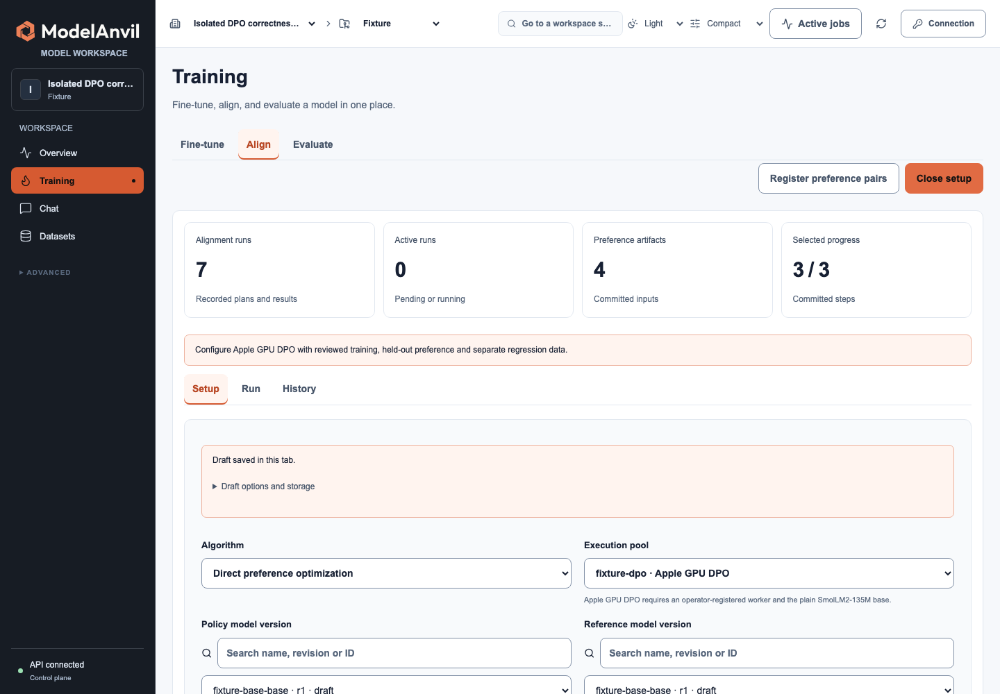
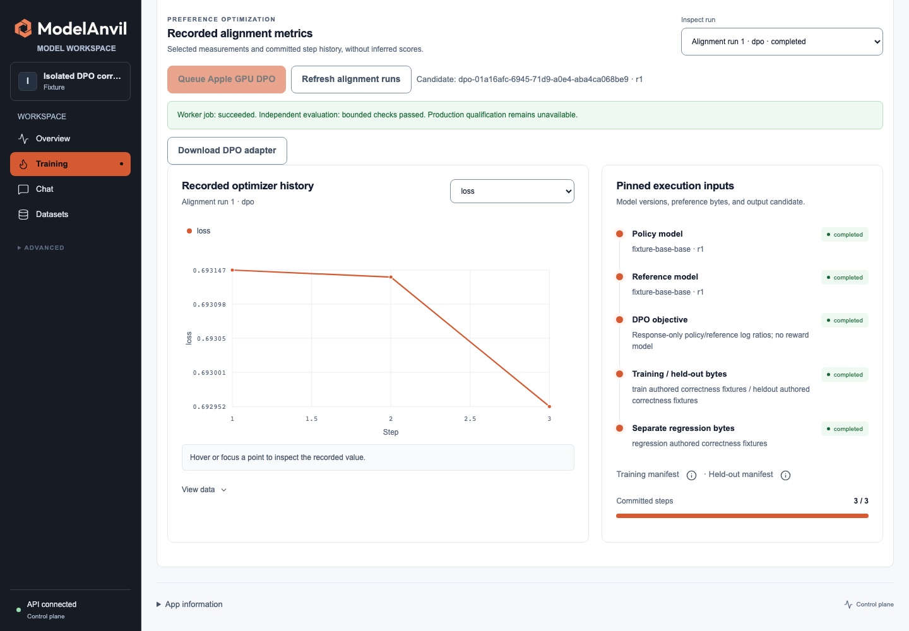
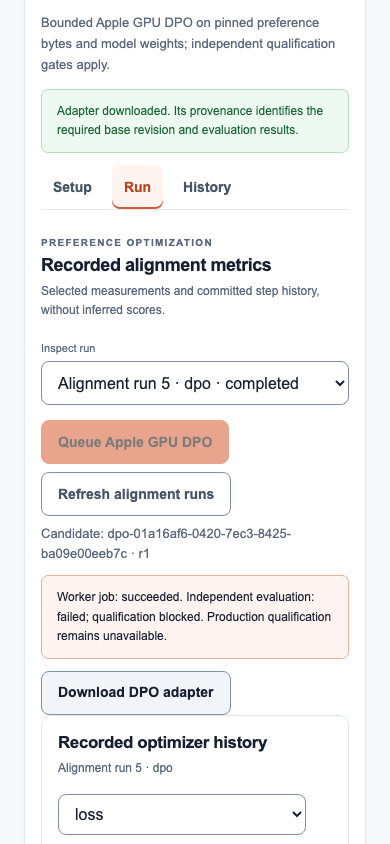

# TASK-23: bounded Apple GPU DPO

23 October 2026 UTC. This qualifies the named execution profile on this Mac using authored correctness fixtures and explicit test-owner label attestations. It does not establish independent human judgments, customer usefulness or production model qualification.

## Actual execution

The exact plain SmolLM2-135M revision `93efa2f097d58c2a74874c7e644dbc9b0cee75a2` and five source-file hashes are pinned. Observed hardware was Apple M5 Pro with 48 GiB unified memory. The worker used PyTorch 2.13.0 MPS, Transformers 5.14.0, PEFT 0.21.2 and FP32 rank-eight q/v adapters; CPU fallback was disabled. A separately loaded reference stayed frozen. The source build and individual changed-source hashes are recorded in [source-hashes.json](source-hashes.json).

Three genuine optimizer updates changed 460,800 eligible adapter parameters, with 184,320 changed scalar values in the first update and almost all adapter values changed in later updates. The first step changes the initially zero LoRA B matrices; gradients reach A on subsequent steps. The measured pre/post DPO objectives fell on each update. The worker checked actual parameter and gradient residency, finite losses/weights and nonzero gradients. Current MPS allocations were about 1.09 GB; true peak/reserved counters remain null. After worker unload, current model allocations returned to zero. See [the numerical report](numerical-report.json).

The candidate adapter SHA-256 is `d35468c2141077e2c6096e3c7ed7d8642deeae39977ca1f7349328744b3be23f`; Adam state SHA-256 is `eec1a2328367d56d0d38db8e6a978994bbea2c38bb55602fd1707342d964a9ff`. Lease expiry after a real first committed update produced a new attempt. Recovery reached byte-identical adapter and Adam files at step three. The expired attempt could not commit a result. Cancellation after one committed update published no candidate and settled one step.

The corpus contains three training pairs, two protected preference pairs and two separate regression pairs, with unique prompts and disjoint source-group IDs. All are authored mechanical facts with leading-space responses and stable plain-text token boundaries. No customer data or generic quality benchmark is represented. All three sets retain their registered raw hashes and review attestations; source code contains the exact fixture triples.

## Independent checks and negative gates

A separate offline CPU process loaded the exact base and candidate files, importing neither Django nor ModelAnvil. Its log-softmax/gather response scoring is independent of the worker's summed cross-entropy implementation. Both baseline and candidate achieved 1.0 preference accuracy on the two authored held-out pairs. Candidate reference-relative DPO loss was 0.69298223, below the unchanged baseline's log(2). Separate chosen-response regression NLL per token changed from 3.27854919 to 3.27748998. These tiny fixtures establish execution and gate behavior, without demonstrating general improvement.

Reversing the held-out labels produced a real failed DPO quality check. Injecting a missing scoring executable after genuine MPS updates produced an explicit unavailable gate. Both outputs remained draft with `independent_evaluation_passed: false`. The release gate remains closed even for the passing fixture candidate.

The [corruption and scope checks](corruption-and-scope-report.json) changed one byte in an owned isolated base artifact and restored it in `finally`. The worker refused it before any update or candidate publication and settled zero. A changed worker contract could not claim an attempt. Another project could not read the alignment run, its job or its download. Busy hardware and unsupported settings were refused before job/budget allocation. Registered owner attestations require a matching authenticated registration audit; formal exports must match snapshot ID, artifact ID, SHA-256 and byte size. A regression test injects persisted-reference corruption beyond the existing immutable artifact guard and verifies refusal.

## Browser and exported candidate

The [actual browser report](browser-report.json) covers desktop 1440px and mobile 390px configuration, three artifact selections, GPU queueing, a real operator worker, completion polling, quality state and adapter download. The final run verifies that the completed candidate name appears immediately after polling ends. The failed-quality state remains visible separately from job success. No page errors or horizontal document overflow occurred. A separate [setup confirmation](browser-setup-confirmation.json) checks that creating a plan shows setup instructions rather than another run's failure message. The browser's disk picker was deliberately made unavailable to exercise its bounded download fallback.

The downloaded ZIP's adapter/config hashes and exact Apache license were verified. A clean CPU consumer independently loaded that archive with the pinned base and generated eight greedy tokens. Actual application CPU and MPS completions matched it, and the candidate appeared in the scoped inference catalog. See [the ZIP/application report](independent-zip-and-api-report.json).





## Validation and reproduction

The full local backend suite passed **1,136 tests**, with 11 optional/environment skips, in 515.728 seconds. After the final formal-export hash/size tightening, all **10 affected DPO job/math tests** passed. Final-head CI reruns the complete suite. All **232 frontend tests**, production build and Storybook build passed. Django system/migration checks and whitespace checks passed. Numerical proofs ran serially; this was not an idle-host performance benchmark.

```sh
python manage.py test modelanvil.runners.alignment.test_mps_dpo_jobs modelanvil.runners.alignment.test_torch_dpo --noinput
python scripts/qualify_mps_dpo.py --model-dir /absolute/verified/SmolLM2-135M --output /absolute/new/dpo-proof
```

The opt-in command requires the exact optional packages and actual MPS hardware, creates a fresh database/artifact directory, and disables fixture authority in `finally`. No model download, existing application database or paid resource is used. The [operator guide](../../apple-dpo.md) documents setup, bounds, APIs and qualification semantics. Initial development attempts that hit unsupported MPS gather backward are retained privately and are not counted as passing evidence; deterministic execution stayed enforced when the objective implementation was corrected.

Final [cleanup](cleanup-report.json) verifies no active fixture keys, workers, slots, jobs or unsettled reservations. Owned API/Vite services were stopped. Customer work, other GPU vendors, unsupported models/templates, ORPO/KTO and production release qualification remain separate holds.
