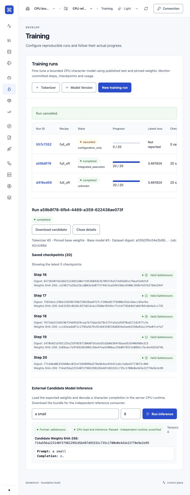

# TASK-4 review package · 11 October 2026

TASK-1 and TASK-2 were accepted by the developer. TASK-4 is implemented and ready for review. TASK-5 still requires TASK-4 acceptance before implementation.

The delivered path fine-tunes a bounded CPU character model from verified published samples and pinned base weights/tokenizer. Browser launch reserves an exact training-step budget and a durable job atomically; repeated launch does not duplicate allocation. Worker commits are fenced, checkpoints contain actual tensors and optimizer/cursor state, and retry produces the same weights as uninterrupted execution. Successful result publication creates one downloadable candidate and one settled usage event. Other recipes remain explicit simulations.

Read the [qualification report](../qualification-reports/text-finetuning-runtime.md), [measured browser run](../qualification-reports/task4-browser-run.json), [actual candidate](../qualification-reports/task4-browser-candidate.json), and [automated pilot](../qualification-reports/cpu-character-pilot.json).

## Criteria and evidence

| Criterion | Evidence |
| --- | --- |
| Immutable dataset, compatible base/tokenizer, qualified runner/pool; unsupported combinations stop | Actual verified artifact bytes, canonical text encoding, fixed CPU contract and limits, missing/incompatible input and changed-resource tests |
| Atomic idempotent launch and budgeted durable job | One job/reservation/outbox on replay; changed payload rejected; budget failure rolls back all allocations; step policy enforced |
| Actual metrics, tensors, optimizer state and provenance | Numerical SGD and finite-difference gradients; per-step checksummed float32 checkpoint with pins/cursor/metrics/attempt; archived final checkpoint and usage |
| Cancellation, interruption, fences, recovery and external inference | Cancellation injected during update; lease expiry during step 3; no stale publication; replacement equals uninterrupted weight hash; corrupt checkpoint rejected; separate `python -I` consumer; actual browser cancellation and download |
| Qualification report naming environment, versions, limits and usage | Apple M5 Pro/macOS arm64/CPython 3.12.15/Django 5.2.18/SQLite/local artifact report; explicit small-model scope and limitations |

## Validation

- [Full backend log](task4-backend-tests.txt): **476 tests OK, 3 skipped**.
- [Final runtime/evidence log](task4-runtime-evidence-tests.txt): **20 tests OK** after adding historical-contract evidence coverage (13 CPU runtime tests plus 7 evidence tests).
- [Web log](task4-web-tests.txt): **91 tests OK**.
- [Build log](task4-web-build.txt): TypeScript/Vite build passed.
- Django system check passed; migration drift check reported no changes.
- CUA browser pilot used an isolated temporary SQLite database and local artifacts. It launched/completed 20 steps, showed measured loss/checkpoints, decoded inference, downloaded actual weights, and cancelled a separate queued run with zero usage. The downloaded candidate loaded in a separate Python process with identical token IDs, text and digest.

The web suite primarily checks helpers/source contracts; the live browser pilot covers the launch/detail/export/inference interactions. Three existing skips include checks requiring PostgreSQL. No PostgreSQL concurrency, GPU, provider-storage or general LLM qualification is asserted. CPU measurements exclude DB/queue/storage overhead and uncommitted work. Monetary costs remain unknown. TASK-5 adds the combined user-facing preflight and capacity/estimate presentation.

## Changed implementation files

- `modelanvil/runners/training/runtime.py`: bounded recipe contract, verified input resolution, actual text encoding, pinned execution, fenced step publication, recovery and terminal candidate/accounting.
- `modelanvil/runners/training/engine.py`: correct SGD gradients and embedding updates; real character decoding for character bundles.
- `modelanvil/runners/training/executor.py`: select the bounded worker runtime separately from synthetic fixtures.
- `modelanvil/jobs/models.py`: finalize candidate/accounting inside the live result transaction, and settle terminal lease-recovery outcomes.
- `modelanvil/api/views/training_views.py`: strict default worker launch, explicit simulation mode, immutable dispatched configuration, transactional idempotency/reservation, safe cancellation, existing-candidate export/infer and checkpoint summaries.
- `modelanvil/api/views/jobs_artifacts.py`: protect training jobs from generic mutation/deletion/cancel; expose dataset registry IDs/names used by the browser.
- `modelanvil/api/views/registries.py`: expose runner registry ID used by launch.
- `modelanvil/core/exceptions.py`: preserve complete scalar validation reasons instead of splitting messages into individual characters.
- `modelanvil/runners/evidence.py`: server-owned measured worker evidence; old/unrecognized worker contracts remain unknown.
- `modelanvil/runners/management/commands/setup_cpu_training_reference.py` and package initializers: explicit local reference setup without launching compute.
- `scripts/cpu_character_infer.py`: independent standard-library consumer without platform imports.
- `web/src/pages/TrainingPage.tsx`: CPU launch inputs, preserved retry key, polling, acknowledged cancellation, candidate download, latest checkpoints and inference isolation per selected run.
- `modelanvil/runners/training/test_cpu_runtime.py`: actual text/base/dispatch/budget/SGD/recovery/cancellation/immutability/reference-consumer acceptance regressions.
- `modelanvil/runners/training/test_text_finetuning_journey.py`: label legacy tests as synthetic fixtures and assert simulation cannot allocate compute.
- `modelanvil/api/test_expanded_apis.py`, `modelanvil/api/test_project_boundaries.py`: explicitly select simulation for existing fixture/boundary tests.
- `docs/engineering/capability-evidence.md`, `docs/engineering/status.md`, qualification report/JSON/bundle/screenshot and this package: current evidence and support boundaries.

The repository remains on `main` with pre-existing untracked project files. No commit, PR or merge is claimed. Review the named files and archived evidence; the workspace's untracked state prevents a conventional isolated Git diff.
