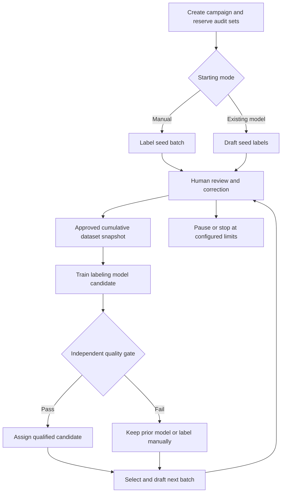

# ModelAnvil iterative labeling workflow

Product specification | 8 October 2026 | Proposed R1 scope in PRD 0.7

We will support a repeated labeling loop: label a seed batch manually or review an existing model's drafts, train a labeling model from approved data, use it to draft the next batch, review and correct the predictions, and repeat. This document expands ANN04–ANN07 and acceptance scenario 17. The complete automatic loop remains planned. The current Annotation workspace implements manual/imported-draft campaign setup, review, pause/resume, batch closure, and cumulative approved snapshot export. See [frontend coverage](engineering/frontend-workspace.md) for supported actions and remaining gaps.

## Campaign setup

Choose a versioned source pool, label schema, rubric, task, compatible drafting/training backend, batch size, review roles, and budget/cycle limits. Reserve source-group-aware validation/audit and final test sets before training. Select a manual or model-assisted seed. Starting the labels from scratch means manual annotation; it does not require training a foundation model from random weights.

The drafting model can be a registered existing model, a fine-tuned model, or a qualified task-specific classifier. The labeling model need not be the final model being built. R1 qualifies at least one text task through both seed paths. Additional label types and modalities need their own correction UI, trainer, and evaluator.

## Repeated cycle

1. **Select a batch.** Pick unused, eligible examples manually or with a reproducible random policy. Record membership, selection policy, source groups, and schema/rubric revisions. Advanced uncertainty, disagreement, and diversity selection are Targets; they are not prerequisites for the basic loop.
2. **Create drafts or label manually.** A manual seed begins with empty labels. A model-assisted batch records the exact model, prompt/context recipe where applicable, generation settings, and label mapping. Invalid or failed predictions remain explicit and can fall back to manual labeling.
3. **Review and correct.** Reviewers accept without editing, correct, reject, skip, or escalate each prediction. Resolve disagreements and concurrent edits. Preserve the original prediction, correction diff, reviewer identity, and decision. Approval never erases model origin.
4. **Close the batch.** Check review completeness and schema validity, then commit an immutable approved-data snapshot. Skipped examples can be deferred; rejected or unresolved annotations do not become training labels. Record counts and exclusions rather than requiring every source example to have an approved label.
5. **Train a candidate.** Use the accumulated approved dataset, including earlier cycles, with a declared training recipe. Choose a fresh run from the pinned base or continue a prior labeling checkpoint where the recipe supports it. Record weighting/replay rules and avoid counting previous data twice unintentionally. Preflight checks data sufficiency and required label classes.
6. **Qualify and choose.** Evaluate against independent human-labeled validation/audit evidence and task-specific gates. Compare with the current drafting model. Promote the candidate if the configured decision permits it; otherwise keep the previous model or continue manually. A failed candidate never replaces a qualified version silently.
7. **Draft the next batch.** Assign a fixed model revision to the new batch and repeat review, correction, training, and qualification. Existing batches retain their assigned revision. Explicit re-drafting creates a new prediction revision without overwriting human work.

For example, a team could manually review 100 seed examples, train model version 1, review its next 200 drafts, train version 2 from the accumulated 300 approved examples, and continue with another batch. These numbers illustrate the flow; useful batch size and minimum training data depend on the task. A model version may fail qualification, and quality need not improve every round.

## Approval and automation

Human approval is required for labels entering the default campaign training snapshot. Manual advance is the default. An authorized owner can configure automatic training after batch closure and automatic next-batch drafting after a candidate passes named gates, within explicit budgets, maximum cycles, and source scope. This automates orchestration while retaining label review.

Support pauses during selection, drafting, review, training, and qualification. Pause prevents future stages and requests cancellation of active jobs through the shared lifecycle; distinguish requested cancellation from confirmed stop. Preserve saved reviews, committed snapshots, and verified checkpoints. Stop on exhausted sources, budget/cycle limits, regressions, or inadequate data, and show how to proceed manually or revise the campaign.

## Review quality and measurements

Track held-out task metrics alongside accepted-without-edit, corrected, rejected, skipped, and adjudicated counts. Measure reviewed throughput, time per approved label, review agreement, class/source/language coverage, training/prediction usage, and human effort. Record how review time is measured and exclude idle time under a declared policy. Acceptance rates and model confidence alone do not establish correctness.

Use a representative audit set labeled without draft visibility or independently adjudicated. Keep audit cases out of training; use validation for cycle selection and reserve the final test for final qualification. When uncertainty sampling is introduced, targeted review batches must not substitute for a representative quality audit. Report error examples and slices to expose systematic mistakes and reviewer anchoring.

Task metrics depend on labels: classification can use accuracy and per-class precision/recall/F1; span tasks need an explicit matching rule; generated labels need schema checks and a task rubric. Candidate integrations must declare which scores they provide. Distinguish calibrated probabilities, backend scores, and self-reported model confidence. Expose missing scores and sample counts. A higher model score or fewer edits cannot independently promote a candidate.

Maintain separate states for predicted, human-authored, model-origin accepted, human-corrected, rejected, skipped, and adjudicated records. Review state and provenance are separate fields. Export filters can choose approved human-only origins or approved model-assisted labels while retaining lineage. Unreviewed pseudo-label training is outside the default loop.

## Versions and recovery

The lineage chain is campaign → cycle → batch/source IDs → original draft revision → human review revisions → approved dataset snapshot → training run → labeling model version → qualification report → next-batch assignment. Include schema, rubric, prompt/context recipe, model, tokenizer/processor, environment, and recipe versions. Model training and prediction remain separately metered jobs.

Schema or rubric changes create new revisions and require compatibility review or migration before mixing old labels into training. Concurrent reviewers must not silently overwrite one another. Duplicate completion callbacks cannot close a batch twice, create a second training trigger, or publish conflicting models. Reviewed labels remain immutable history; corrections create new revisions.

Rollback changes the drafting-model assignment for future work and preserves approved corrections. Explicitly re-draft selected unfinished items if desired, showing the changed model and prediction diff. Retention, permission revocation, and source deletion rules remain current across prior model assignments and exported data. Previously trained weights retain lineage for any deletion-impact decision.

## Implementation boundaries

PostgreSQL owns campaign states, review records, batch closure, and model assignments. RabbitMQ dispatches draft prediction, preparation, training, and evaluation work through the existing durable claims/leases protocol. S3-compatible storage holds source assets, manifests, approved snapshots, and checkpoints. Compatible CPU/GPU workers execute the stages; label submission does not train a model inside a Django request.

Label Studio's prediction import and ML backend interfaces are candidates for reuse. Its documentation distinguishes community workflows from enterprise automated active learning, so ModelAnvil must qualify the exact edition, schema mapping, identity/access behavior, and prediction/review round trip. We own the loop rather than assuming a frontend supplies it. No integration is selected as implemented. [Label Studio ML integration](https://labelstud.io/guide/ml.html), [prediction import](https://labelstud.io/guide/predictions.html).

## Acceptance evidence

Both entry modes must complete a reviewed seed and two train-and-next-batch cycles on one named text task. Show that training uses the approved cumulative snapshots, preserves original model predictions and human revisions, excludes held-out groups, pins the model per batch, handles invalid drafts and insufficient data, rejects a failing candidate, and supports pause/resume and rollback. Inject duplicate completion and worker interruption fixtures. Enforce cycle/budget limits and tenant isolation. Record task metrics, review effort, hardware/backend versions, and known limitations.
